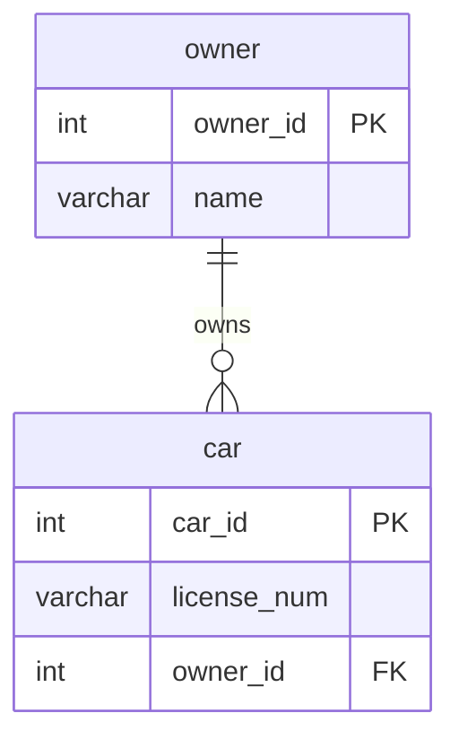
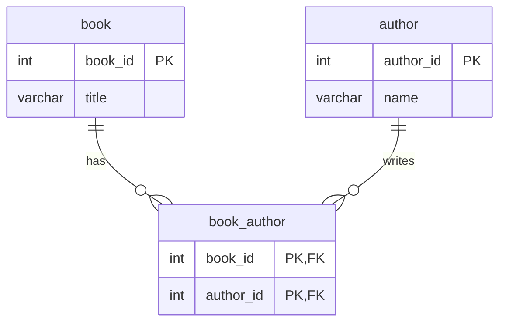
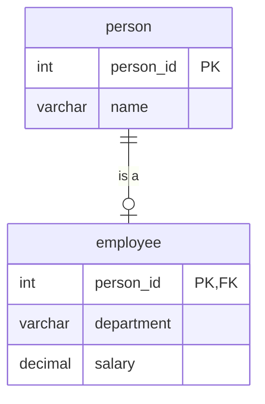

> Step through each explorer with the arrows (or press play), then use the last step to change the data. In the exam, a quick sketch of the two tables with lines between matching rows answers most JOIN questions.

## 1. What each JOIN keeps (cheat sheet §6)

The 2024 papers' tables: `fish` (6 rows) holds a foreign key to `bicycle` (3 rows). Green rows are matched, amber rows are kept with NULLs on the other side, grey rows are dropped. In the last step, change how many fish have no bicycle and how many bicycles nobody rides: the CROSS count never moves, and the LEFT count from `fish` stays at 6, which is why those are the two counts you can give from the sizes alone.

```graph
type: sql-joins
```

## 2. The order of execution (cheat sheet §5)

Written `SELECT … FROM … WHERE … GROUP BY … HAVING … ORDER BY`, run `FROM → WHERE → GROUP BY → HAVING → SELECT → ORDER BY`. Watch WHERE strike single rows, GROUP BY sort the survivors into buckets, and HAVING strike a whole bucket. In the last step, move both thresholds.

```graph
type: sql-group-by
```

## 3. ERD to tables (cheat sheet §1)

The 2024 Moed A (3437) ERD: course, student and semester each have a one-to-many link to grade. **4 tables, 3 FKs, all in `grade`.**

![[PP03_q1_source_erd.png]]

The same paper's fish and bicycle tables:

![[PP03_q2_source_fish_bicycle_tables.png]]

The 2026 Moed A Diagram B: students and courses many-to-many, one lecturer per course. **4 tables** (with `enrollment`), **3 FKs**; "every lecturer teaches at least one course" cannot be enforced.

![[pp08-diagram-b.jpg]]

### The three relationship patterns as tables

One-to-many: one FK, in the child. Add `NOT NULL` for "exactly one parent", `UNIQUE` for one-to-one.



Many-to-many: a junction table with two FKs. A composite PK stops repeated pairs.



Inheritance ("is a"): the child's PK is also its FK to the parent.



The problem-set ERDs. Exercise 1, a hospital, drawn conceptually and then logically. Read off: the weak entity Medical Record takes the patient's PK as its own PK and FK, and each many-to-many (patient and treatment, doctor and treatment) becomes a junction table whose PK is the two FKs.

![[PS01_q1_student_erd.png]]

Exercise 2, a restaurant's logical ERD. Read off: `order_item` is the junction between orders and menu items with its own attributes (quantity, unit price), and `payment.order_id` is an FK with `UNIQUE`, so each order has at most one payment: a one-to-one.

![[PS02_q1_student_logical_erd.png]]
