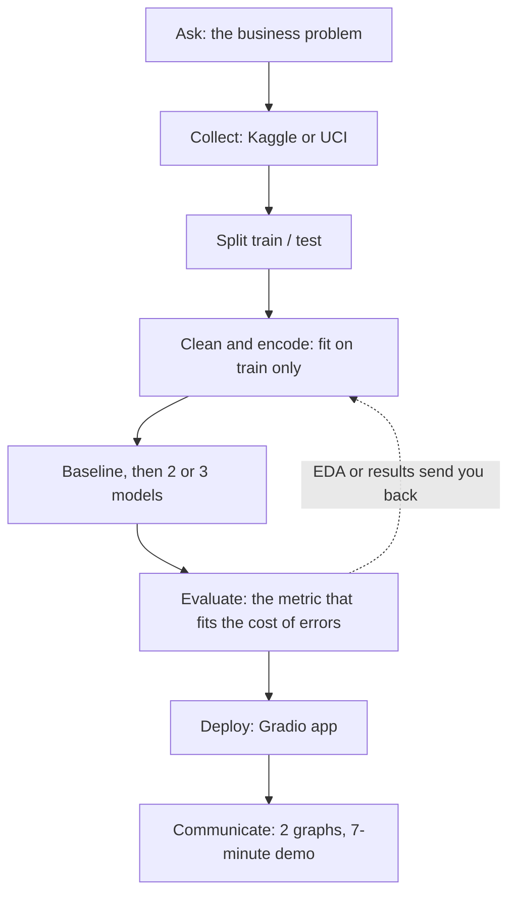

> Step through each explorer with the arrows (or press play), then use the last step to change the data. Each one answers a question the project Q&A tends to ask; the question is in the heading.

## 0. The project pipeline



## 1. Why plot before you model? (Lecture 2)

Four datasets with the same mean, variance, correlation and regression line.

```graph
type: anscombe-quartet
```

## 2. Why not just report accuracy? (Lecture 3)

Five churners among fifty members: "nobody churns" scores 90%. Move the threshold and watch precision and recall trade off.

```graph
type: ds-precision-recall
```

## 3. How does KNN decide, and what does K do? (Lecture 3)

```graph
type: knn-classifier
```

## 4. How do you know the model isn't overfitting? (Lecture 4)

Too simple misses the pattern; too complex fits the noise. The test error is the judge.

```graph
type: bias-variance
```

## 5. Why cross-validate instead of one split? (Lecture 4)

```graph
type: cross-validation
```

## 6. How does K-Means find the segments? (Lecture 5)

```graph
type: k-means
```

## 7. What does PCA keep? (Lecture 5)

```graph
type: pca-projection
```
