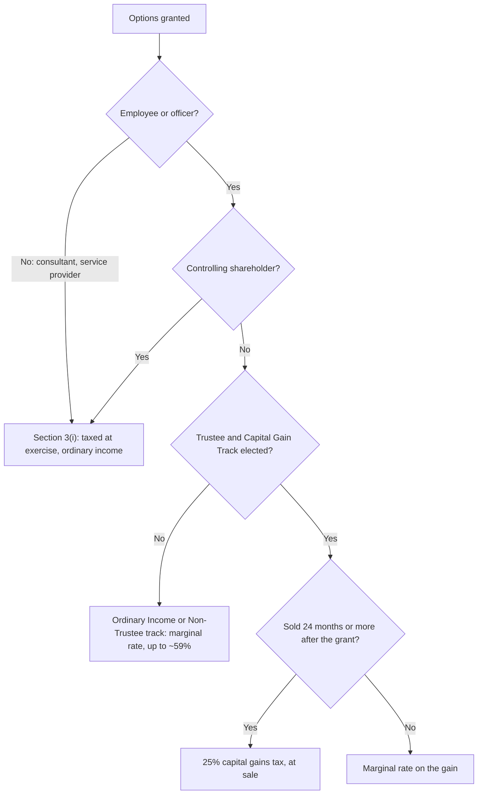
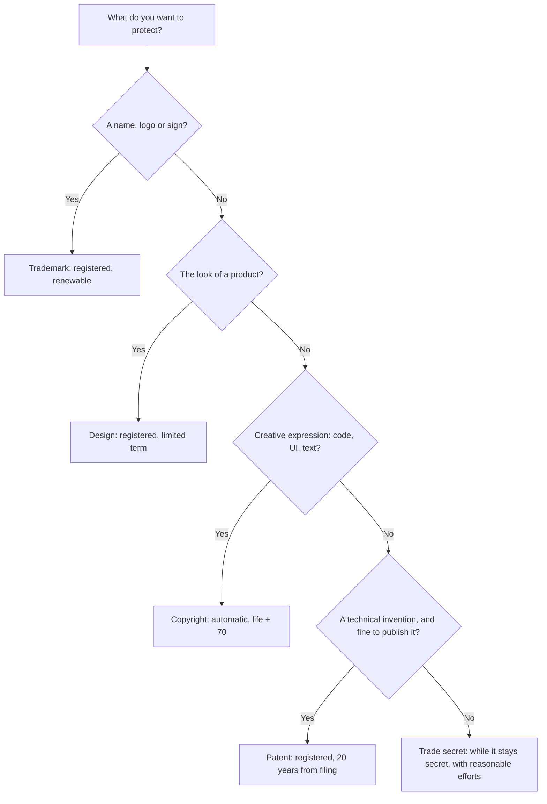
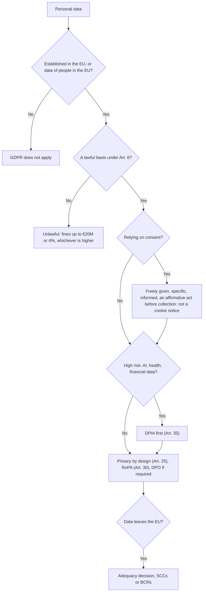
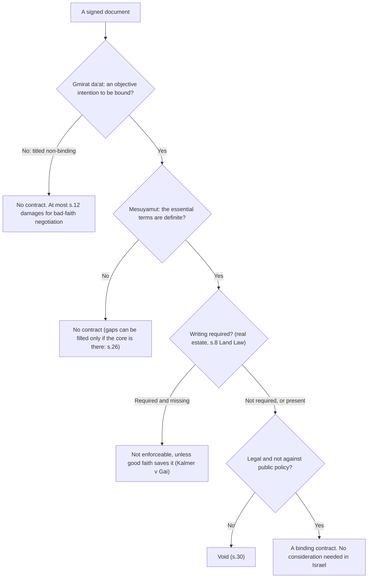
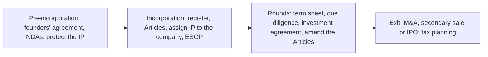
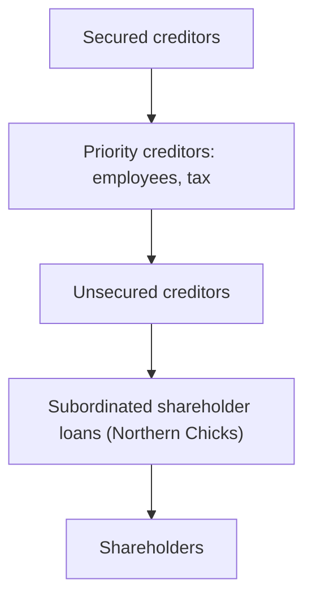

> Step through each explorer with the arrows (or press play), then use the last step to change the numbers. The decision trees are the order to ask the questions in an MCQ or a case.

## 1. A funding round on the cap table (cheat sheet §8)

Lecture 8's case study: \$2.5M for 25%, fully diluted. The bar's length is the share count, so the founders' slices keep their length while their percentages fall. In the last step, flip the pool between pre-money and post-money and watch who pays for it.

```graph
type: legal-cap-table
```

## 2. An option grant over time (cheat sheet §7)

4,800 options with a 4-year vesting schedule and a 1-year cliff. The green zone starts **24 months after the grant**, not after vesting or exercise. In the last step, move the leaving and sale dates and switch the reason for leaving.

```graph
type: legal-esop-timeline
```

## 3. Which tax rule?



## 4. Which IP right?



Whichever it is, the **creator** owns it until a **written assignment** to the company.

## 5. Does the GDPR bite, and what do you need?



## 6. Is it a contract?



## 7. The startup lifecycle and its legal to-dos



## 8. Who gets paid first in an insolvency


