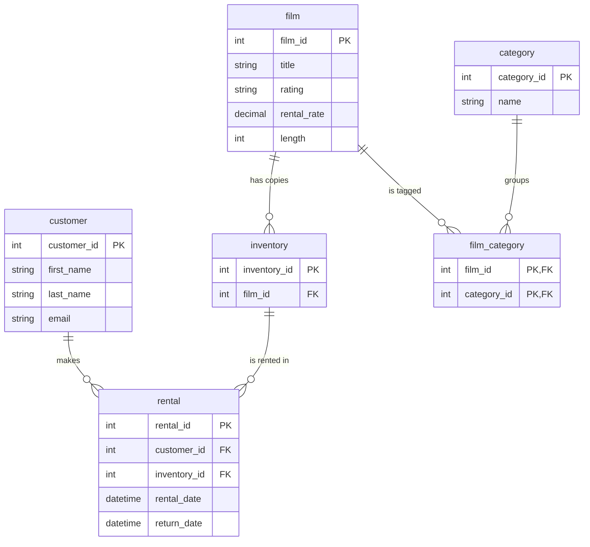

# SQL Keywords, Concepts & Exam Tips

> [!warning] Study aid, not course material. This guide was AI-generated (per the source PDF's metadata). Verify against the course before relying on it.

> [!info] What this note is
> A reading note built from a two-part study guide: an **8-page exam guide** (core clauses, traps, classic queries) and an **expanded keyword reference** with 50 numbered practice questions. It is organised by topic rather than in the guide's order. Every example uses the **Sakila** DVD-rental database (tables `film`, `inventory`, `rental`, `customer`, `payment`, `category`, `film_category`). The guide's code is **MySQL** flavoured; MySQL-specific or doubtful claims carry a `> [!warning]` with a correction.

> [!note] Where the guide is thin
> The guide covers **SQL queries and DDL/DML** well, but ERD design, cardinality and normalisation get only a few lines each. The ERD in the relationships section is my illustration drawn from the join paths the guide uses, not a diagram from the guide.

## 1. Relational database concepts

| Concept | Meaning | Example |
|---|---|---|
| **Entity** | A real-world object, stored as a table | `customer`, `film` |
| **Attribute** | A column describing an entity | `first_name`, `rental_rate` |
| **Tuple** | A single row | one customer record |
| **Relationship** | A link between tables | `film` and `inventory` |
| **Cardinality** | How many rows on one side relate to how many on the other (one-to-one, one-to-many, many-to-many) | one customer has many rentals |
| **Normalisation** | Organising data to reduce redundancy | 1NF, 2NF, 3NF |

> [!warning] Terminology is loose
> In ERD vocabulary an **entity** is a thing you model, and it becomes a **table** only when you translate the ERD into a logical (relational) schema. Strictly, "tuple" and "attribute" are relational-model terms (row and column of a relation). Use the instructor's wording in the exam.

### Relationships and cardinality

One-to-many is the workhorse: the "one" side's primary key is copied into the "many" side as a **foreign key**. Many-to-many needs a **junction (link) table** holding two foreign keys, as `film_category` does between `film` and `category`.



> [!note] Reconstructed from the guide's queries
> The guide only states "one customer, many rentals" and "`film` to `inventory`". The rest of the diagram (the `film_category` junction, key columns) is inferred from the joins in its practice questions 6, 8 and 50.

### Normalisation (as the guide states it)

- **1NF**: atomic values, no repeating groups.
- **2NF**: 1NF plus no **partial dependencies** (no non-key attribute depends on only part of a composite key).
- **3NF**: 2NF plus no **transitive dependencies** (no non-key attribute depends on another non-key attribute).

> [!warning] Guide's definitions are one-liners
> The guide does not define partial dependency itself; the parenthetical above is the standard textbook meaning, added by me. It also says nothing of BCNF or functional dependencies.

## 2. DDL: Data Definition Language

DDL defines and changes **structure** (tables, views, indexes), not the rows.

| Keyword | What it does |
|---|---|
| **CREATE TABLE** | Creates a new table |
| **ALTER TABLE** | Changes an existing table (add, drop or modify a column, add a constraint) |
| **DROP TABLE** | Deletes the table and its data permanently |
| **TRUNCATE TABLE** | Removes all rows but keeps the table structure |

```sql
CREATE TABLE customer (
  customer_id INT PRIMARY KEY AUTO_INCREMENT,
  first_name VARCHAR(50) NOT NULL,
  last_name VARCHAR(50) NOT NULL,
  email VARCHAR(100) UNIQUE,
  created_at DATETIME DEFAULT NOW()
);

ALTER TABLE customer
ADD COLUMN phone VARCHAR(20);

ALTER TABLE customer
DROP COLUMN phone;

ALTER TABLE customer
MODIFY COLUMN email VARCHAR(150);

ALTER TABLE rental
ADD CONSTRAINT fk_customer
FOREIGN KEY (customer_id) REFERENCES customer(customer_id);

DROP TABLE customer;

TRUNCATE TABLE temp_data;
```

> [!tip] Exam tip
> `DELETE` removes **data**; `DROP` removes **structure**. `TRUNCATE` sits between: all rows gone, structure kept (see question 39).

> [!warning] MySQL-specific
> `AUTO_INCREMENT` and `MODIFY COLUMN` are MySQL. Standard SQL uses `GENERATED ... AS IDENTITY`; PostgreSQL has `SERIAL`; SQL Server has `IDENTITY` and `ALTER COLUMN`.

## 3. DML: Data Manipulation Language

DML changes the **rows** inside existing tables.

| Keyword | What it does |
|---|---|
| **INSERT INTO** | Adds new rows (single row, several rows, or from a `SELECT`) |
| **UPDATE** | Modifies existing rows |
| **DELETE** | Removes rows |

```sql
-- single row
INSERT INTO customer (first_name, last_name, email)
VALUES ('John', 'Doe', 'john.doe@email.com');

-- several rows
INSERT INTO customer (first_name, last_name, email)
VALUES
  ('Jane', 'Smith', 'jane@email.com'),
  ('Bob', 'Johnson', 'bob@email.com');

-- insert from a SELECT
INSERT INTO film_backup (film_id, title, rental_rate)
SELECT film_id, title, rental_rate
FROM film
WHERE rating = 'G';

UPDATE film
SET rental_rate = rental_rate * 1.1
WHERE length > 120;

DELETE FROM rental
WHERE return_date < DATE_SUB(NOW(), INTERVAL 5 YEAR);
```

> [!warning] Always use WHERE
> `UPDATE` or `DELETE` without a `WHERE` hits **every row**. (Not stated in the guide; standard practice.)

## 4. Keys and constraints

A **constraint** is a rule the database enforces on table data.

| Constraint | Meaning |
|---|---|
| **PRIMARY KEY** | Uniquely identifies each row; unique and NOT NULL; one per table |
| **FOREIGN KEY** | Column that references the primary key of another table; enforces referential integrity |
| **UNIQUE** | No two rows may share the value |
| **NOT NULL** | The column cannot be NULL |
| **CHECK** | Restricts allowed values |
| **DEFAULT** | Value used when none is supplied |
| **AUTO_INCREMENT** | Automatically increasing numeric ID (MySQL) |

```sql
CREATE TABLE rental (
  rental_id INT PRIMARY KEY AUTO_INCREMENT,
  customer_id INT NOT NULL,
  rental_date DATETIME NOT NULL,
  return_date DATETIME,
  rating_check VARCHAR(5) CHECK (rating_check IN ('G', 'PG', 'R')),
  FOREIGN KEY (customer_id)
    REFERENCES customer(customer_id)
    ON DELETE CASCADE
    ON UPDATE CASCADE
);
```

**Referential actions** (what happens to child rows when the parent row is deleted or updated):

| Action | Effect |
|---|---|
| **CASCADE** | Automatically delete or update the related rows |
| **SET NULL** | Set the foreign key to NULL |
| **RESTRICT** | Block the delete or update if rows reference it |
| **NO ACTION** | Similar to RESTRICT |

> [!warning] Corrections and MySQL notes
> - A **foreign key** may reference any **UNIQUE/candidate key**, not only a primary key.
> - A **UNIQUE** column normally still allows NULL; MySQL allows several NULLs in one UNIQUE column.
> - A **primary key** can be **composite** (several columns), as in `film_category`; "one per table" means one key definition, not one column.
> - **CHECK** is enforced only from MySQL 8.0.16 (older versions parse and ignore it).
> - The line "NO ACTION is similar to RESTRICT" is right for MySQL; in standard SQL the check is deferred to end of statement.

## 5. SELECT clauses and the logical order of execution

SQL is **written** top to bottom but **evaluated** in a different logical order.

| Keyword | What it does | Example |
|---|---|---|
| **SELECT** | Chooses which columns appear in the output | `SELECT title, rental_rate` |
| **FROM** | Specifies the source table(s) | `FROM film` |
| **WHERE** | Filters rows before aggregation | `WHERE length > 120` |
| **AS** | Renames a column or table (alias) | `AVG(rental_rate) AS avg_rate` |
| **DISTINCT** | Removes duplicate values | `SELECT DISTINCT rating` |
| **ORDER BY** | Sorts the final result | `ORDER BY rental_rate DESC` |
| **LIMIT** | Restricts the number of rows returned | `LIMIT 5` |
| **OFFSET** | Skips the first N rows (pagination) | `LIMIT 10 OFFSET 20` |

```sql
SELECT title, rental_rate
FROM film
WHERE rental_rate > 3
ORDER BY rental_rate DESC
LIMIT 5;
```

> [!tip] Exam tip
> `ORDER BY` and `LIMIT` always come at the end of the query.

### Logical order of execution

| Step | Clause | What happens |
|---|---|---|
| 1 | FROM | Identifies and loads the source table(s) |
| 2 | JOIN | Combines tables using the join conditions |
| 3 | WHERE | Filters individual rows before grouping |
| 4 | GROUP BY | Groups the filtered rows |
| 5 | HAVING | Filters the groups after aggregation |
| 6 | SELECT | Calculates expressions and finalises output columns |
| 7 | ORDER BY | Sorts the result |
| 8 | LIMIT / OFFSET | Restricts the number of rows |

Memory aid from the guide: **F**rom **J**oins **W**here **G**roup **H**aving **S**elect **O**rder **L**imit.

> [!tip] Final exam insight
> Because `WHERE` runs **before** `SELECT`, a column alias defined in `SELECT` cannot be used in `WHERE` (question 28).

> [!warning] Simplifications
> - `JOIN` is really part of the `FROM` step, not a separate stage.
> - `DISTINCT` runs after `SELECT` and before `ORDER BY`; window functions are evaluated just before `SELECT` output is finalised. The guide omits both.
> - **MySQL** (unlike standard SQL) also lets you use a `SELECT` alias in `GROUP BY` and `HAVING`; only `WHERE` rejects it.
> - `LIMIT`/`OFFSET` is MySQL/PostgreSQL. SQL Server uses `TOP`; standard SQL uses `FETCH FIRST n ROWS ONLY`.

## 6. Conditions and pattern matching

| Operator | Meaning | Example |
|---|---|---|
| **AND** | All conditions must be true | `length > 100 AND rating = 'PG'` |
| **OR** | At least one condition true | `rating = 'PG' OR rating = 'G'` |
| **NOT** | Negates a condition | `NOT rating = 'R'` |
| **IN / NOT IN** | Matches (or excludes) a list of values | `rating IN ('PG','G')` |
| **BETWEEN** | **Inclusive** range | `rental_rate BETWEEN 2 AND 5` |
| **LIKE / NOT LIKE** | Pattern matching | `title LIKE 'A%'` |
| **%** | Wildcard: any number of characters | `'A%'` starts with A |
| **_** | Wildcard: exactly one character | `'A_'` is A plus one character |

```sql
SELECT title, rating, length
FROM film
WHERE rating IN ('PG', 'G')
  AND length BETWEEN 90 AND 120
  AND title NOT LIKE '%War%';
```

> [!warning] Conceptual warning
> `BETWEEN` includes **both** boundary values.

> [!warning] Precedence (guide's pitfall table is misleading)
> The guide says to fix `a = 1 OR b = 2 AND c = 3` with `a = 1 OR (b = 2 AND c = 3)`. Those two are **identical**, because `AND` already binds tighter than `OR`. The real fix is to parenthesise **what you mean**: for `(a = 1 OR b = 2) AND c = 3` the brackets are essential.

## 7. Aggregate functions

An **aggregate function** summarises many rows into one value.

| Function | What it does | Example |
|---|---|---|
| **COUNT(\*)** | Counts rows (includes rows with NULLs) | `COUNT(*)` |
| **COUNT(column)** | Counts non-NULL values only | `COUNT(return_date)` |
| **COUNT(DISTINCT column)** | Counts unique non-NULL values | `COUNT(DISTINCT customer_id)` |
| **SUM** | Adds numeric values | `SUM(amount)` |
| **AVG** | Mean of the values | `AVG(rental_rate)` |
| **MIN** | Lowest value | `MIN(length)` |
| **MAX** | Highest value | `MAX(length)` |

```sql
SELECT COUNT(*)
FROM rental
WHERE return_date IS NULL;

SELECT COUNT(*), COUNT(return_date), COUNT(DISTINCT customer_id)
FROM rental;
```

> [!tip] Critical exam trap
> `COUNT(*)` is **not** `COUNT(column)`: the second skips NULLs. The guide calls this "very frequent in MCQs".

> [!warning] Course format
> The guide keeps referring to MCQs, but this course's past papers are written-answer exams. Treat the trap as something to *explain*, not just spot. Also, `SUM`, `AVG`, `MIN`, `MAX` all **ignore NULLs** (not stated in the guide), so `AVG` is not "sum divided by row count" when NULLs exist.

## 8. GROUP BY and HAVING

- **GROUP BY** defines the grouping level: one output row per distinct combination of the grouped columns.
- **HAVING** filters **groups** after aggregation.
- **WHERE** filters **rows** before grouping.

| Aspect | WHERE | HAVING |
|---|---|---|
| Runs | Before GROUP BY | After GROUP BY |
| Filters | Individual rows | Grouped results |
| Aggregate functions allowed | No | Yes |
| Efficiency | Filters early | Filters after aggregation |

```sql
SELECT rating, AVG(rental_rate) AS avg_rate
FROM film
WHERE length > 100
GROUP BY rating
HAVING AVG(rental_rate) > 3;
```

> [!tip] Exam tip
> If the condition contains an **aggregate function**, you almost certainly need `HAVING`.

> [!warning] Rule the guide implies but never states
> Every non-aggregated column in `SELECT` must appear in `GROUP BY` (standard SQL; MySQL enforces it with `ONLY_FULL_GROUP_BY`, on by default since 5.7). Questions 42 and 46 rely on it. Also the guide's pitfall "using HAVING for non-aggregated filters" is legal but wasteful: move such filters to `WHERE`.

## 9. JOINs

A **JOIN** combines rows from several tables; **ON** gives the matching condition.

| Join | Result | Example |
|---|---|---|
| **INNER JOIN** (or `JOIN`) | Only rows matching in both tables | `JOIN inventory i ON f.film_id = i.film_id` |
| **LEFT JOIN** | All left rows plus matching right rows (NULLs where none) | `LEFT JOIN rental r ON i.inventory_id = r.inventory_id` |
| **RIGHT JOIN** | All right rows plus matching left rows | `RIGHT JOIN staff s ON r.staff_id = s.staff_id` |
| **CROSS JOIN** | Cartesian product: every left row paired with every right row | `CROSS JOIN category` |
| **ON** | The join condition | `ON f.film_id = i.film_id` |

```sql
-- films with their rental counts, keeping films never rented
SELECT f.title, COUNT(r.rental_id)
FROM film f
LEFT JOIN inventory i ON f.film_id = i.film_id
LEFT JOIN rental r ON i.inventory_id = r.inventory_id
GROUP BY f.title;

-- anti-join: films never rented
SELECT f.title
FROM film f
LEFT JOIN inventory i ON f.film_id = i.film_id
LEFT JOIN rental r ON i.inventory_id = r.inventory_id
WHERE r.rental_id IS NULL;
```

> [!tip] Study tip from the guide
> Draw Venn diagrams for INNER, LEFT and RIGHT joins. A `CROSS JOIN` of m rows by n rows gives m x n rows (stated as "every row from left x right").

### The "WHERE on the right table of a LEFT JOIN" trap

The guide labels this as wrong and correct:

```sql
-- guide's "wrong" version
LEFT JOIN rental r ON i.inventory_id = r.inventory_id
WHERE r.return_date IS NULL;
```

```sql
-- guide's "correct" version
LEFT JOIN rental r
ON i.inventory_id = r.inventory_id
AND r.return_date IS NULL;
```

> [!warning] The guide's explanation is wrong or at best muddled
> The guide says "using WHERE on the right table of a LEFT JOIN removes NULL rows" and (question 3) that `WHERE r.return_date IS NULL` makes the LEFT JOIN behave like an INNER JOIN. That is **not** true for `IS NULL`: this predicate actually **keeps** the unmatched left rows (their right-side columns are NULL), and it is exactly the **anti-join** idiom the guide itself uses in question 4 (`WHERE r.rental_id IS NULL`).
>
> The real trap is a **null-rejecting** condition such as `WHERE r.return_date > '2025-01-01'` or `WHERE r.rental_id = 5` on the right table. Unmatched rows have NULL there, the comparison is not TRUE, and they vanish, so the LEFT JOIN collapses into an INNER JOIN. Put such a condition in `ON` to keep the outer join.
>
> The "correct" version also **changes the meaning**: it keeps every inventory row and attaches only open rentals, instead of selecting rows whose return date is missing.

> [!warning] Not in the guide
> The guide omits **FULL OUTER JOIN** (all rows from both sides). MySQL does not support it; you emulate it with `LEFT JOIN ... UNION ... RIGHT JOIN`. It also lists the old **implicit join** (`FROM a, b WHERE a.id = b.id`) as a pitfall: use explicit `JOIN ... ON` instead.

## 10. Subqueries

A **subquery** is a query nested inside another.

| Type | What it does | Example |
|---|---|---|
| **Scalar subquery** | Returns a single value | `WHERE rental_rate > (SELECT AVG(rental_rate) FROM film)` |
| **IN subquery** | Returns a list of values | `WHERE film_id IN (SELECT film_id FROM inventory)` |
| **EXISTS subquery** | Checks whether the subquery returns any row | `WHERE EXISTS (SELECT 1 FROM rental WHERE ...)` |
| **Correlated subquery** | References a column of the outer query, so it is re-evaluated per outer row | `WHERE rental_rate > (SELECT AVG(...) FROM film f2 WHERE f2.rating = f.rating)` |

```sql
-- scalar: films above the average rental rate
SELECT title, rental_rate
FROM film
WHERE rental_rate > (SELECT AVG(rental_rate) FROM film);

-- IN: customers who have made rentals
SELECT first_name, last_name
FROM customer
WHERE customer_id IN (SELECT DISTINCT customer_id FROM rental);

-- EXISTS (correlated): films that have been rented
SELECT title
FROM film f
WHERE EXISTS (
  SELECT 1
  FROM inventory i
  JOIN rental r ON i.inventory_id = r.inventory_id
  WHERE i.film_id = f.film_id
);
```

> [!warning] Guide's performance claim and a NOT IN hazard
> - "JOINs are usually more performant than subqueries" is a rule of thumb; modern optimisers often rewrite one into the other. Do not state it as a fact.
> - `NOT IN (subquery)` returns **no rows at all** if the subquery yields even one NULL (because `x <> NULL` is unknown). The guide's question 11 is safe only because `rental.customer_id` is NOT NULL. `NOT EXISTS` or a `LEFT JOIN ... IS NULL` is safer.

## 11. NULL handling

**NULL** means unknown or missing. It is not equal to anything, **not even another NULL**.

| Keyword | What it does | Example |
|---|---|---|
| **IS NULL** | Tests for a missing value | `WHERE return_date IS NULL` |
| **IS NOT NULL** | Tests for a present value | `WHERE return_date IS NOT NULL` |
| **COALESCE()** | Returns the first non-NULL argument | `COALESCE(return_date, 'Not Returned')` |
| **IFNULL() / ISNULL()** | Replaces NULL (MySQL / SQL Server) | `IFNULL(phone, 'No Phone')` |
| **NULLIF()** | Returns NULL if the two values are equal | `NULLIF(value1, value2)` |

```sql
SELECT rental_id, rental_date,
       COALESCE(return_date, 'Still Rented') AS return_status
FROM rental
WHERE return_date IS NULL;
```

> [!tip] Exam tip
> Never use `=` to check for NULL: `NULL = NULL` evaluates to NULL (not TRUE), so `WHERE x = NULL` returns nothing. Use `IS NULL`.

> [!warning] Corrections
> - `COALESCE(return_date, 'Still Rented')` mixes a DATETIME with a string. MySQL coerces it, but stricter databases reject it; `CAST` the date to text first.
> - `ISNULL` differs by product: in **MySQL** `ISNULL(x)` only returns 1 or 0 (a test); the two-argument replacing form is **SQL Server**.
> - Three-valued logic: a `WHERE` keeps a row only when the condition is TRUE, not FALSE **or unknown**.

## 12. Set operations

| Keyword | What it does |
|---|---|
| **UNION** | Combines results, removes duplicates |
| **UNION ALL** | Combines results, keeps duplicates (faster) |
| **INTERSECT** | Rows that appear in both queries |
| **EXCEPT / MINUS** | Rows in the first query but not the second |

Requirements: the same number of columns, compatible data types; column names come from the first query.

```sql
SELECT first_name FROM customer WHERE customer_id < 10
UNION
SELECT first_name FROM customer WHERE customer_id > 590;

SELECT id FROM table1
EXCEPT
SELECT id FROM table2;
```

> [!warning] Dialect
> `MINUS` is Oracle; `EXCEPT` is standard and PostgreSQL/SQL Server. MySQL supports `INTERSECT` and `EXCEPT` only from **8.0.31**.

## 13. CASE (conditional logic)

**CASE** is SQL's if-else: `WHEN` states the condition, `THEN` the result, `ELSE` the default, `END` closes it.

```sql
-- searched CASE
SELECT title,
  CASE
    WHEN rental_rate < 2 THEN 'Cheap'
    WHEN rental_rate BETWEEN 2 AND 4 THEN 'Medium'
    ELSE 'Expensive'
  END AS price_category
FROM film;

-- simple CASE (equality check)
SELECT title,
  CASE rating
    WHEN 'G' THEN 'General Audience'
    WHEN 'PG' THEN 'Parental Guidance'
    WHEN 'R' THEN 'Restricted'
    ELSE 'Not Rated'
  END AS rating_description
FROM film;
```

## 14. Common Table Expressions (CTEs)

A **CTE** (`WITH`) defines a temporary named result set you can query like a table, to break a complex query into readable steps.

```sql
WITH expensive_films AS (
  SELECT film_id, title, rental_rate
  FROM film
  WHERE rental_rate > 4
)
SELECT ef.title, COUNT(r.rental_id) AS rental_count
FROM expensive_films ef
LEFT JOIN inventory i ON ef.film_id = i.film_id
LEFT JOIN rental r ON i.inventory_id = r.inventory_id
GROUP BY ef.title;

-- several CTEs, comma separated
WITH
  high_rated AS (
    SELECT film_id, title FROM film WHERE rating IN ('PG-13', 'R')
  ),
  frequent_rentals AS (
    SELECT i.film_id, COUNT(*) AS rental_count
    FROM inventory i
    JOIN rental r ON i.inventory_id = r.inventory_id
    GROUP BY i.film_id
    HAVING COUNT(*) > 10
  )
SELECT hr.title, fr.rental_count
FROM high_rated hr
JOIN frequent_rentals fr ON hr.film_id = fr.film_id;
```

> [!note] Small edit
> The guide wrote `GROUP BY film_id` here. I qualified it as `i.film_id` for clarity (only `inventory` has that column in this join).

## 15. Window functions

A **window function** computes a value across a set of related rows **without collapsing them** (unlike `GROUP BY`). `OVER` defines the window; `PARTITION BY` splits it into groups.

| Function | What it does |
|---|---|
| **ROW_NUMBER()** | Unique sequential number: 1, 2, 3, 4, 5 |
| **RANK()** | Rank with gaps after ties: 1, 2, 2, 4, 5 |
| **DENSE_RANK()** | Rank without gaps: 1, 2, 2, 3, 4 |
| **PARTITION BY** | Divides the result into partitions |
| **OVER** | Defines the window specification |
| **LAG()** | Value from the previous row |
| **LEAD()** | Value from the next row |

```sql
-- rank within each rating
SELECT title, rating, rental_rate,
  RANK() OVER (PARTITION BY rating ORDER BY rental_rate DESC) AS rank_in_category
FROM film;

-- running total
SELECT payment_date, amount,
  SUM(amount) OVER (ORDER BY payment_date) AS running_total
FROM payment;

-- previous and next rental dates
SELECT rental_date,
  LAG(rental_date, 1) OVER (ORDER BY rental_date) AS previous_date,
  LEAD(rental_date, 1) OVER (ORDER BY rental_date) AS next_date
FROM rental;
```

> [!warning] Not always covered
> Window functions need MySQL 8.0 or later. They cannot appear in `WHERE`; filter on them by wrapping the query in a CTE or subquery (as question 37 does).

## 16. String, date and maths functions

| Group | Functions (as listed in the guide) |
|---|---|
| **String** | `UPPER`, `LOWER`, `LENGTH`, `SUBSTRING(title, 1, 5)`, `CONCAT(first_name, ' ', last_name)`, `TRIM`, `LTRIM`, `RTRIM`, `REPLACE(title, 'The', 'A')`, `LEFT(title, 3)`, `RIGHT(title, 3)` |
| **Date and time** | `NOW()`, `CURDATE()` / `CURRENT_DATE`, `CURTIME()`, `YEAR`, `MONTH`, `DAY`, `DATEDIFF(return_date, rental_date)`, `DATE_ADD`, `DATE_SUB`, `TIMESTAMPDIFF(HOUR, rental_date, return_date)` |
| **Maths** | `ROUND(AVG(amount), 2)`, `CEIL` / `CEILING`, `FLOOR`, `ABS`, `MOD(10, 3)` returns 1, `POWER(2, 3)` returns 8, `SQRT(16)` returns 4 |
| **Type conversion** | `CAST(rental_rate AS DECIMAL(5,2))`, `CONVERT(rental_rate, CHAR)` |

```sql
SELECT CONCAT(UPPER(last_name), ', ', first_name) AS full_name,
       LENGTH(email) AS email_length
FROM customer;

SELECT rental_id,
       DATEDIFF(return_date, rental_date) AS days_out,
       DATE_ADD(rental_date, INTERVAL 7 DAY) AS due_date
FROM rental;

SELECT ROUND(AVG(amount), 2) AS average_payment
FROM payment;

SELECT CAST('123' AS SIGNED);
```

> [!warning] MySQL-specific
> `DATEDIFF` (two arguments, days), `CURDATE`, `DATE_ADD`, `DATE_SUB`, `TIMESTAMPDIFF`, `MONTHNAME`, `LENGTH` (bytes, not characters: use `CHAR_LENGTH` for characters) and `CONVERT(x, CHAR)` are MySQL forms. SQL Server's `DATEDIFF` takes three arguments (`DATEDIFF(day, a, b)`); the standard function is `CURRENT_DATE`. Wrapping a column in a function such as `YEAR(rental_date)` in `WHERE` also stops an index being used on that column.

## 17. Views

A **view** is a stored query that behaves like a virtual table; it holds no data of its own.

```sql
CREATE VIEW active_customers AS
SELECT c.customer_id, c.first_name, c.last_name, COUNT(r.rental_id) AS rental_count
FROM customer c
JOIN rental r ON c.customer_id = r.customer_id
GROUP BY c.customer_id, c.first_name, c.last_name
HAVING COUNT(r.rental_id) > 5;

SELECT *
FROM active_customers
WHERE rental_count > 10;

CREATE OR REPLACE VIEW active_customers AS
SELECT customer_id, first_name, last_name
FROM customer;

DROP VIEW active_customers;
```

## 18. Indexes

An **index** is a lookup structure on one or more columns that speeds up reads.

```sql
CREATE INDEX idx_last_name ON customer(last_name);
CREATE UNIQUE INDEX idx_email ON customer(email);
DROP INDEX idx_last_name ON customer;
```

- **Why:** speeds up `SELECT`, but slows down `INSERT`, `UPDATE` and `DELETE`.
- **Use on:** columns frequently in `WHERE`, `JOIN` and `ORDER BY`.
- **LIKE performance:** `LIKE '%term%'` (leading wildcard) cannot use a normal index; `LIKE 'term%'` can.

> [!warning] Heuristics, not rules
> Guide's "avoid indexes under 1000 rows" and "avoid on low-cardinality columns" are rules of thumb. Indexes on a **foreign key** column are usually worth having. `DROP INDEX ... ON table` is MySQL syntax.

## 19. Transactions and ACID

A **transaction** is a sequence of SQL operations treated as one unit of work.

| Keyword | What it does |
|---|---|
| **BEGIN / START TRANSACTION** | Starts a transaction |
| **COMMIT** | Saves all changes permanently |
| **ROLLBACK** | Undoes all changes since `BEGIN` |
| **SAVEPOINT** | Creates a checkpoint inside the transaction |
| **ROLLBACK TO** | Rolls back to a savepoint |

```sql
BEGIN;
UPDATE account SET balance = balance - 100 WHERE account_id = 1;
UPDATE account SET balance = balance + 100 WHERE account_id = 2;
COMMIT;
-- on error, run ROLLBACK; instead of COMMIT;
```

**ACID**: **Atomicity** (all or nothing), **Consistency** (data stays valid), **Isolation** (transactions do not interfere), **Durability** (changes are permanent after `COMMIT`).

## 20. Exam tips (the guide's final section)

> [!tip] The guide's classic traps, collected
> 1. **Execution order**: FROM, JOIN, WHERE, GROUP BY, HAVING, SELECT, ORDER BY, LIMIT. It explains why aliases fail in `WHERE`.
> 2. **WHERE filters rows, HAVING filters groups.** An aggregate in the condition means `HAVING`.
> 3. **NULL**: `NULL = NULL` is not TRUE. Always `IS NULL` / `IS NOT NULL`.
> 4. **COUNT(\*) counts all rows; COUNT(column) skips NULLs.**
> 5. **JOIN types**: draw Venn diagrams for INNER, LEFT, RIGHT. Watch conditions on the right table of a LEFT JOIN (see the warning in section 9).
> 6. **DELETE removes data, DROP removes structure.**
> 7. **BETWEEN is inclusive.**
> 8. **ORDER BY and LIMIT go last.**
> 9. **Subqueries vs JOINs**: often interchangeable.
> 10. **Window functions** give ranking, running totals and comparisons without `GROUP BY`; **CTEs** make complex queries readable.
> 11. **Indexes** on columns used in `WHERE`, `JOIN`, `ORDER BY`, but not on everything.
> 12. **Test on small data first**; check for NULLs and empty results.

**Guide's pitfall table**

| Issue | Problem | Fix |
|---|---|---|
| NULL comparisons | `WHERE value = NULL` does not work | `WHERE value IS NULL` |
| HAVING vs WHERE | HAVING used for non-aggregate filters | Filter in `WHERE` before `GROUP BY` |
| COUNT(\*) vs COUNT(column) | `COUNT(column)` excludes NULLs | Use `COUNT(*)` to count all rows |
| Implicit joins | `FROM a, b WHERE a.id = b.id` | Explicit `JOIN` syntax |
| OR with AND | Mixed `OR` and `AND` | Parenthesise (see the warning in section 6) |
| LIKE performance | `LIKE '%term%'` cannot use an index | Avoid a leading wildcard |

## 21. Practice questions with the guide's answers

> [!warning] Unverified
> These 50 questions and answers come from the AI-generated guide. They were **not** run against a Sakila database. Answers marked with a warning contain an error or a MySQL-only feature. All use Sakila table names.

### Basic SELECT and filtering

**Q1.** Select all films with a rental rate greater than 3.50, ordered by title alphabetically.

```sql
SELECT *
FROM film
WHERE rental_rate > 3.50
ORDER BY title ASC;
```

**Q2.** Customers whose last name starts with 'S' and first name ends with 'n'; show first and last name.

```sql
SELECT first_name, last_name
FROM customer
WHERE last_name LIKE 'S%' AND first_name LIKE '%n';
```

**Q3.** Films rated 'PG' or 'G' with length between 90 and 120; return title, rating, length.

```sql
SELECT title, rating, length
FROM film
WHERE rating IN ('PG', 'G')
  AND length BETWEEN 90 AND 120;
```

### Aggregate functions and GROUP BY

**Q4.** Average, minimum and maximum rental rate per rating, ordered by average descending.

```sql
SELECT rating,
       AVG(rental_rate) AS avg_rate,
       MIN(rental_rate) AS min_rate,
       MAX(rental_rate) AS max_rate
FROM film
GROUP BY rating
ORDER BY avg_rate DESC;
```

**Q5.** Rating categories with more than 200 films; show rating and count.

```sql
SELECT rating, COUNT(*) AS film_count
FROM film
GROUP BY rating
HAVING COUNT(*) > 200;
```

**Q6.** Films rented per customer, only customers with more than 30.

```sql
SELECT c.customer_id, c.first_name, c.last_name, COUNT(r.rental_id) AS rental_count
FROM customer c
JOIN rental r ON c.customer_id = r.customer_id
GROUP BY c.customer_id, c.first_name, c.last_name
HAVING COUNT(r.rental_id) > 30
ORDER BY rental_count DESC;
```

### JOINs

**Q7.** All films with their inventory count, including films with no inventory.

```sql
SELECT f.title, COUNT(i.inventory_id) AS inventory_count
FROM film f
LEFT JOIN inventory i ON f.film_id = i.film_id
GROUP BY f.film_id, f.title
ORDER BY f.title;
```

**Q8.** Returned rentals: customer name, film title, rental date, return date.

```sql
SELECT c.first_name, c.last_name, f.title, r.rental_date, r.return_date
FROM rental r
JOIN customer c ON r.customer_id = c.customer_id
JOIN inventory i ON r.inventory_id = i.inventory_id
JOIN film f ON i.film_id = f.film_id
WHERE r.return_date IS NOT NULL
ORDER BY r.rental_date;
```

**Q9.** Difference between INNER JOIN and LEFT JOIN, with an example of each. Guide's answer: INNER JOIN returns only rows with a match in both tables; LEFT JOIN returns all left rows with matching right rows (NULL if none).

```sql
-- INNER: customers who made at least one rental
SELECT DISTINCT c.customer_id, c.first_name, c.last_name
FROM customer c
INNER JOIN rental r ON c.customer_id = r.customer_id;

-- LEFT: all customers with their rental count, including zero
SELECT c.customer_id, c.first_name, c.last_name, COUNT(r.rental_id) AS rental_count
FROM customer c
LEFT JOIN rental r ON c.customer_id = r.customer_id
GROUP BY c.customer_id, c.first_name, c.last_name;
```

### Subqueries

**Q10.** Films with a rental rate above the average.

```sql
SELECT title, rental_rate
FROM film
WHERE rental_rate > (SELECT AVG(rental_rate) FROM film)
ORDER BY rental_rate DESC;
```

**Q11.** Customers who never rented (subquery with NOT IN).

```sql
SELECT customer_id, first_name, last_name
FROM customer
WHERE customer_id NOT IN (SELECT DISTINCT customer_id FROM rental);
```

> [!warning] NOT IN and NULLs
> Fine here only because `rental.customer_id` is never NULL (see section 10).

**Q12.** Films rented at least once (EXISTS).

```sql
SELECT f.film_id, f.title
FROM film f
WHERE EXISTS (
  SELECT 1
  FROM inventory i
  JOIN rental r ON i.inventory_id = r.inventory_id
  WHERE i.film_id = f.film_id
);
```

**Q13.** For each film, compare its rental rate with the average for its rating (correlated subquery).

```sql
SELECT f1.title, f1.rating, f1.rental_rate,
       (SELECT AVG(f2.rental_rate)
        FROM film f2
        WHERE f2.rating = f1.rating) AS category_avg,
       f1.rental_rate - (SELECT AVG(f2.rental_rate)
                         FROM film f2
                         WHERE f2.rating = f1.rating) AS difference_from_avg
FROM film f1
ORDER BY f1.rating, f1.rental_rate DESC;
```

### CASE

**Q14.** Categorise films by length: Short (under 60), Medium (60 to 120), Long (over 120).

```sql
SELECT title, length,
  CASE
    WHEN length < 60 THEN 'Short'
    WHEN length BETWEEN 60 AND 120 THEN 'Medium'
    ELSE 'Long'
  END AS length_category
FROM film
ORDER BY length;
```

**Q15.** Rental status: Returned, Overdue (not returned and more than 7 days ago), Current.

```sql
SELECT rental_id, rental_date, return_date,
  CASE
    WHEN return_date IS NOT NULL THEN 'Returned'
    WHEN return_date IS NULL AND rental_date < DATE_SUB(NOW(), INTERVAL 7 DAY) THEN 'Overdue'
    ELSE 'Current'
  END AS rental_status
FROM rental
ORDER BY rental_date DESC;
```

### String and date functions

**Q16.** Full names as "LASTNAME, Firstname".

```sql
SELECT CONCAT(UPPER(last_name), ', ', first_name) AS full_name
FROM customer
ORDER BY last_name;
```

> [!warning] "Proper case"
> The query does **not** convert the first name to proper case; it just reuses `first_name` as stored (MySQL has no built-in `INITCAP`).

**Q17.** Rentals made in January 2025 with their duration in days.

```sql
SELECT rental_id, rental_date, return_date,
       DATEDIFF(return_date, rental_date) AS rental_duration_days
FROM rental
WHERE YEAR(rental_date) = 2025 AND MONTH(rental_date) = 1
  AND return_date IS NOT NULL
ORDER BY rental_duration_days DESC;
```

**Q18.** Rentals per year.

```sql
SELECT YEAR(rental_date) AS rental_year, COUNT(*) AS rental_count
FROM rental
GROUP BY YEAR(rental_date)
ORDER BY rental_year;
```

### Window functions

**Q19.** Rank films by rental rate within each rating.

```sql
SELECT
  RANK() OVER (PARTITION BY rating ORDER BY rental_rate DESC) AS rank_in_category,
  title,
  rating,
  rental_rate
FROM film
ORDER BY rating, rank_in_category;
```

**Q20.** Running total of payments by date.

```sql
SELECT payment_id, payment_date, amount,
       SUM(amount) OVER (ORDER BY payment_date) AS running_total
FROM payment
ORDER BY payment_date;
```

**Q21.** Row numbers by length (longest first), top 10.

```sql
SELECT ROW_NUMBER() OVER (ORDER BY length DESC) AS row_num,
       title,
       length
FROM film
LIMIT 10;
```

> [!warning] Ties are arbitrary
> `LIMIT 10` has no `ORDER BY`, so which rows tie-break into the top 10 is not guaranteed. Add `ORDER BY row_num`.

### CTEs

**Q22.** CTE of above-average rental-rate films, then the count per rating.

```sql
WITH above_avg_films AS (
  SELECT film_id, title, rating, rental_rate
  FROM film
  WHERE rental_rate > (SELECT AVG(rental_rate) FROM film)
)
SELECT rating, COUNT(*) AS film_count, AVG(rental_rate) AS avg_rate
FROM above_avg_films
GROUP BY rating
ORDER BY film_count DESC;
```

**Q23.** Two CTEs (rental_rate above 4; length above 120), films that are both.

```sql
WITH high_value AS (
  SELECT film_id, title, rental_rate
  FROM film
  WHERE rental_rate > 4
),
long_films AS (
  SELECT film_id, title, length
  FROM film
  WHERE length > 120
)
SELECT hv.title, hv.rental_rate, lf.length
FROM high_value hv
JOIN long_films lf ON hv.film_id = lf.film_id
ORDER BY hv.rental_rate DESC;
```

### Set operations

**Q24.** Customer IDs in both `customer` and `rental` (INTERSECT or equivalent).

```sql
-- INTERSECT (if supported)
SELECT customer_id FROM customer
INTERSECT
SELECT customer_id FROM rental;

-- alternative with JOIN
SELECT DISTINCT c.customer_id
FROM customer c
JOIN rental r ON c.customer_id = r.customer_id;
```

**Q25.** Films never in inventory (EXCEPT/MINUS or NOT IN).

```sql
-- NOT IN
SELECT film_id, title
FROM film
WHERE film_id NOT IN (SELECT DISTINCT film_id FROM inventory);

-- LEFT JOIN
SELECT f.film_id, f.title
FROM film f
LEFT JOIN inventory i ON f.film_id = i.film_id
WHERE i.film_id IS NULL;
```

### NULL handling

**Q26.** Rentals with a NULL return date, shown as 'Still Rented'.

```sql
SELECT rental_id, rental_date,
       COALESCE(return_date, 'Still Rented') AS return_status
FROM rental
WHERE return_date IS NULL;
```

**Q27.** Why does `WHERE column = NULL` not work? Guide's answer: NULL is unknown or missing, equal to nothing (not even NULL), and `NULL = NULL` evaluates to NULL, not TRUE. Use:

```sql
WHERE column IS NULL
WHERE column IS NOT NULL
```

### Execution order

**Q28.** Why does this query error?

```sql
SELECT title, rental_rate * 2 AS doubled_rate
FROM film
WHERE doubled_rate > 6;
```

Guide's answer: `WHERE` runs before `SELECT`, so the alias `doubled_rate` does not exist yet. Fixes:

```sql
SELECT title, rental_rate * 2 AS doubled_rate
FROM film
WHERE rental_rate * 2 > 6;

SELECT *
FROM (
  SELECT title, rental_rate * 2 AS doubled_rate
  FROM film
) AS subquery
WHERE doubled_rate > 6;
```

**Q29.** WHERE versus HAVING. Guide's answer is the table in section 8 plus:

```sql
SELECT rating, AVG(rental_rate) AS avg_rate
FROM film
WHERE length > 100
GROUP BY rating
HAVING AVG(rental_rate) > 3;
```

### Data modification

**Q30.** Insert a customer Alice Johnson.

```sql
INSERT INTO customer (first_name, last_name, email)
VALUES ('Alice', 'Johnson', 'alice.j@email.com');
```

> [!warning] May fail in real Sakila
> Sakila's `customer` table has more NOT NULL columns (`store_id`, `address_id`), so this INSERT would fail there. It is valid only on the guide's simplified `customer` table.

**Q31.** Raise `rental_rate` by 10% for rating 'G'.

```sql
UPDATE film
SET rental_rate = rental_rate * 1.10
WHERE rating = 'G';
```

**Q32.** Delete rentals returned more than 5 years ago.

```sql
DELETE FROM rental
WHERE return_date < DATE_SUB(NOW(), INTERVAL 5 YEAR);
```

### Complex multi-concept

**Q33.** Top 3 customers by total payment in 2025 (CTE).

```sql
WITH customer_payments AS (
  SELECT c.customer_id, c.first_name, c.last_name, SUM(p.amount) AS total_spent
  FROM customer c
  JOIN payment p ON c.customer_id = p.customer_id
  WHERE YEAR(p.payment_date) = 2025
  GROUP BY c.customer_id, c.first_name, c.last_name
)
SELECT first_name, last_name, total_spent
FROM customer_payments
ORDER BY total_spent DESC
LIMIT 3;
```

**Q34.** Per rating: film count, average length, average rate and a price label (Budget under 2, Standard 2 to 4, Premium over 4).

```sql
SELECT rating,
       COUNT(*) AS film_count,
       ROUND(AVG(length), 2) AS avg_length,
       ROUND(AVG(rental_rate), 2) AS avg_rental_rate,
       CASE
         WHEN AVG(rental_rate) < 2 THEN 'Budget'
         WHEN AVG(rental_rate) BETWEEN 2 AND 4 THEN 'Standard'
         ELSE 'Premium'
       END AS price_category
FROM film
GROUP BY rating
ORDER BY avg_rental_rate DESC;
```

**Q35.** Films rented more often than the average rental count across all films.

```sql
WITH film_rental_counts AS (
  SELECT f.film_id, f.title, COUNT(r.rental_id) AS rental_count
  FROM film f
  LEFT JOIN inventory i ON f.film_id = i.film_id
  LEFT JOIN rental r ON i.inventory_id = r.inventory_id
  GROUP BY f.film_id, f.title
),
avg_rentals AS (
  SELECT AVG(rental_count) AS avg_rental_count
  FROM film_rental_counts
)
SELECT frc.title, frc.rental_count
FROM film_rental_counts frc
CROSS JOIN avg_rentals ar
WHERE frc.rental_count > ar.avg_rental_count
ORDER BY frc.rental_count DESC;
```

**Q36.** Customers who rented in consecutive months.

```sql
WITH customer_months AS (
  SELECT DISTINCT c.customer_id, c.first_name, c.last_name,
         YEAR(r.rental_date) AS rental_year,
         MONTH(r.rental_date) AS rental_month
  FROM customer c
  JOIN rental r ON c.customer_id = r.customer_id
)
SELECT cm1.customer_id, cm1.first_name, cm1.last_name,
       cm1.rental_year, cm1.rental_month AS month1,
       cm2.rental_month AS month2
FROM customer_months cm1
JOIN customer_months cm2
  ON cm1.customer_id = cm2.customer_id
  AND cm1.rental_year = cm2.rental_year
  AND cm2.rental_month = cm1.rental_month + 1
ORDER BY cm1.customer_id, cm1.rental_month;
```

> [!warning] Year boundary bug
> The join requires the same year, so **December to January** pairs are missed. A fix is to compare `rental_year * 12 + rental_month` values differing by 1.

**Q37.** Films ranked 1 to 5 by rental rate within their rating.

```sql
WITH ranked_films AS (
  SELECT title, rating, rental_rate,
         RANK() OVER (PARTITION BY rating ORDER BY rental_rate DESC) AS rate_rank
  FROM film
)
SELECT title, rating, rental_rate, rate_rank
FROM ranked_films
WHERE rate_rank <= 5
ORDER BY rating, rate_rank;
```

> [!warning] Ties
> `RANK` with ties at the top can return **more than 5** films per rating; Sakila's rental rates take only a few distinct values, so expect hundreds of rows with rank 1. The guide does not mention this.

### Transactions and constraints

**Q38.** What is a transaction, and when do you use BEGIN, COMMIT, ROLLBACK? Guide's answer: a sequence of operations treated as one unit of work obeying ACID; `BEGIN` starts, `COMMIT` saves, `ROLLBACK` undoes; use for a bank transfer so both updates succeed or both fail (code in section 19).

**Q39.** DELETE versus TRUNCATE versus DROP (guide's table):

| Aspect | DELETE | TRUNCATE | DROP |
|---|---|---|---|
| What it does | Removes rows | Removes all rows | Removes the entire table |
| Can use WHERE | Yes | No | No |
| Can roll back | Yes (in a transaction) | No (usually) | No |
| Speed | Slower (row by row) | Fast | Instant |
| Triggers | Fires DELETE triggers | Does not fire | Does not fire |
| Auto-increment | Does not reset | Resets | Not applicable |
| Structure | Kept | Kept | Removed |

```sql
DELETE FROM rental WHERE return_date < '2020-01-01';
TRUNCATE TABLE temp_log;
DROP TABLE old_backup_table;
```

> [!warning] Dialect
> In **MySQL**, `TRUNCATE` is DDL: it commits implicitly and cannot be rolled back. In PostgreSQL and SQL Server a `TRUNCATE` inside a transaction **can** be rolled back. Also, `TRUNCATE` fails on a table referenced by a foreign key.

**Q40.** Explain PRIMARY KEY and FOREIGN KEY with an example.

```sql
CREATE TABLE customer (
  customer_id INT PRIMARY KEY AUTO_INCREMENT,
  first_name VARCHAR(50) NOT NULL,
  last_name VARCHAR(50) NOT NULL,
  email VARCHAR(100) UNIQUE
);

CREATE TABLE rental (
  rental_id INT PRIMARY KEY AUTO_INCREMENT,
  customer_id INT NOT NULL,
  rental_date DATETIME NOT NULL,
  return_date DATETIME,
  FOREIGN KEY (customer_id)
    REFERENCES customer(customer_id)
    ON DELETE CASCADE
    ON UPDATE CASCADE
);
```

Guide's answer: a primary key uniquely identifies each row, cannot be NULL, one per table, and automatically gets an index; a foreign key links two tables, references a primary key elsewhere, enforces referential integrity, and a table may have several.

### Performance and best practice

**Q41.** Which performs better: `LIKE '%love%'` or `LIKE 'love%'`?

```sql
SELECT * FROM film WHERE title LIKE '%love%';
SELECT * FROM film WHERE title LIKE 'love%';
```

Guide's answer: the second, because the leading wildcard in the first forces a full table scan, while the second can use an index on `title`. For real text search use a `FULLTEXT` index.

**Q42.** Find the issues and rewrite:

```sql
SELECT title, COUNT(*)
FROM film
WHERE COUNT(*) > 5
GROUP BY rating;
```

Guide's answer: aggregate in `WHERE` (needs `HAVING`), and `title` selected but not in `GROUP BY`. Corrected:

```sql
SELECT rating, COUNT(*) AS film_count
FROM film
GROUP BY rating
HAVING COUNT(*) > 5;
```

**Q43.** When to use or avoid an index. Guide's answer: **use** when the column is frequently in `WHERE`/`JOIN`/`ORDER BY`, has high cardinality, the table is large and reads outnumber writes. **Avoid** for tiny tables, low-cardinality columns, frequently updated columns, write-heavy tables and rarely queried columns.

```sql
CREATE INDEX idx_customer_email ON customer(email);
CREATE INDEX idx_rental_date_customer ON rental(rental_date, customer_id);
```

### Tricky concepts

**Q44.** What does this return?

```sql
SELECT COUNT(*), COUNT(return_date), COUNT(DISTINCT customer_id)
FROM rental;
```

Guide's answer: three counts. `COUNT(*)` counts all rows; `COUNT(return_date)` skips NULLs (rentals not yet returned); `COUNT(DISTINCT customer_id)` counts unique customers. Its sample output:

| COUNT(*) | COUNT(return_date) | COUNT(DISTINCT customer_id) |
|---|---|---|
| 16044 | 15861 | 599 |

> [!warning] Unverified numbers
> The guide's sample figures (16,044 rentals, 183 still out, 599 customers) were not checked against a database here. Also, the guide's bold `**COUNT(*)**` "(including NULLs)" wording is loose: it counts rows, and NULLs only matter for the column counts.

**Q45.** UNION versus UNION ALL.

```sql
SELECT first_name FROM customer WHERE customer_id < 10
UNION
SELECT first_name FROM customer WHERE customer_id > 590;

SELECT first_name FROM customer WHERE customer_id < 10
UNION ALL
SELECT first_name FROM customer WHERE customer_id > 590;
```

Guide's answer: `UNION` removes duplicates (slower, implicit sort), `UNION ALL` keeps them (faster). Use `UNION` when you need distinct results, `UNION ALL` when duplicates are fine or impossible.

> [!warning] "Implicitly sorts"
> Removing duplicates does not guarantee sorted output, and does not have to sort (it may hash). Add `ORDER BY` if order matters.

**Q46.** What is wrong with this query?

```sql
SELECT customer_id, first_name, COUNT(*) AS rental_count
FROM customer
JOIN rental ON customer.customer_id = rental.customer_id;
```

Guide's answer: a GROUP BY violation (non-aggregated columns with an aggregate and no `GROUP BY`). Fixed:

```sql
SELECT c.customer_id, c.first_name, COUNT(*) AS rental_count
FROM customer c
JOIN rental r ON c.customer_id = r.customer_id
GROUP BY c.customer_id, c.first_name
ORDER BY rental_count DESC;
```

> [!warning] Second error missed
> Both tables have a `customer_id` column, so the unqualified `customer_id` in `SELECT` is also **ambiguous**. The guide fixes it silently with the alias.

**Q47.** Second highest rental rate (three methods).

```sql
-- 1: LIMIT with OFFSET
SELECT DISTINCT rental_rate
FROM film
ORDER BY rental_rate DESC
LIMIT 1 OFFSET 1;

-- 2: subquery
SELECT MAX(rental_rate) AS second_highest
FROM film
WHERE rental_rate < (SELECT MAX(rental_rate) FROM film);

-- 3: window function (guide's "most robust")
WITH ranked_rates AS (
  SELECT DISTINCT rental_rate,
         DENSE_RANK() OVER (ORDER BY rental_rate DESC) AS rate_rank
  FROM film
)
SELECT rental_rate AS second_highest
FROM ranked_rates
WHERE rate_rank = 2;
```

### Real-world scenarios

**Q48.** Monthly revenue for 2025 with percentage of the yearly total.

```sql
WITH monthly_revenue AS (
  SELECT
    MONTHNAME(payment_date) AS month_name,
    MONTH(payment_date) AS month_num,
    SUM(amount) AS monthly_total
  FROM payment
  WHERE YEAR(payment_date) = 2025
  GROUP BY MONTHNAME(payment_date), MONTH(payment_date)
),
yearly_total AS (
  SELECT SUM(amount) AS year_total
  FROM payment
  WHERE YEAR(payment_date) = 2025
)
SELECT
  mr.month_name,
  mr.monthly_total,
  ROUND((mr.monthly_total / yt.year_total) * 100, 2) AS percentage_of_year
FROM monthly_revenue mr
CROSS JOIN yearly_total yt
ORDER BY mr.month_num;
```

**Q49.** Loyalty tiers: Gold (30+ rentals), Silver (15 to 29), Bronze (1 to 14), New (0).

```sql
SELECT
  c.customer_id,
  c.first_name,
  c.last_name,
  COUNT(r.rental_id) AS rental_count,
  CASE
    WHEN COUNT(r.rental_id) >= 30 THEN 'Gold'
    WHEN COUNT(r.rental_id) BETWEEN 15 AND 29 THEN 'Silver'
    WHEN COUNT(r.rental_id) BETWEEN 1 AND 14 THEN 'Bronze'
    ELSE 'New'
  END AS loyalty_tier
FROM customer c
LEFT JOIN rental r ON c.customer_id = r.customer_id
GROUP BY c.customer_id, c.first_name, c.last_name
ORDER BY rental_count DESC;
```

**Q50.** Customers who rented from the same category more than 5 times.

```sql
SELECT
  c.customer_id,
  c.first_name,
  c.last_name,
  cat.name AS category_name,
  COUNT(*) AS category_rental_count
FROM customer c
JOIN rental r ON c.customer_id = r.customer_id
JOIN inventory i ON r.inventory_id = i.inventory_id
JOIN film f ON i.film_id = f.film_id
JOIN film_category fc ON f.film_id = fc.film_id
JOIN category cat ON fc.category_id = cat.category_id
GROUP BY c.customer_id, c.first_name, c.last_name, cat.category_id, cat.name
HAVING COUNT(*) > 5
ORDER BY category_rental_count DESC;
```

### The 8-page PDF's five questions

The short PDF has its own five questions (some repeat the above). Answers as the guide gives them:

| # | Question | Guide's answer |
|---|---|---|
| 1 | Why does `WHERE AVG(rental_rate) > 3 ... GROUP BY rating` fail? | Aggregates cannot be used in `WHERE`; use `HAVING AVG(rental_rate) > 3` |
| 2 | `COUNT(*)` vs `COUNT(return_date)`? | `COUNT(*)` counts all rows; `COUNT(return_date)` ignores NULLs |
| 3 | Why does `LEFT JOIN ... ON ... WHERE r.return_date IS NULL` act like an INNER JOIN? | "The WHERE condition removes rows where r is NULL" |
| 4 | Films never rented | `LEFT JOIN` inventory and rental, then `WHERE r.rental_id IS NULL` (query in section 9) |
| 5 | Logical execution order | FROM, JOIN, WHERE, GROUP BY, HAVING, SELECT, ORDER BY, LIMIT |

> [!warning] PDF question 3 is wrong
> As explained in section 9, `WHERE r.return_date IS NULL` **keeps** unmatched left rows, so it does not turn the LEFT JOIN into an INNER JOIN. It contradicts PDF question 4 on the same page.

## Source and trust

- Source: `SQL Keywords and Concepts - Study Guide.html` (expanded reference, 50 numbered questions) and `Sql Keywords, Concepts & Exam Tips (1).pdf` (8 pages, 5 questions). The PDF text layer was clean, so I read it as extracted text rather than as rendered images.
- Both are **AI-generated** and Sakila/MySQL oriented. Cross-check every dialect-specific function and every "Answer" before using it in an exam.
