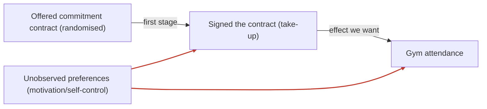

# Difference-in-Differences II (Dynamic DiD)

> Part of: [[Econometrics]]
> **Lecture 11** — Applied Econometrics, Dr. Aluma Dembo
>
> 📄 Slides: [Lecture 11 deck (PDF)](/papers/econometrics/lecture-11-did-ii.pdf)
> Previous: [[Lec_10-Difference-in-Differences]] | Next: [[Lec_12-Course Summary (Late Fees at Daycare)]]
> Key concepts: [[_Econometrics Concepts#Difference-in-Differences|Difference-in-Differences]], [[_Econometrics Concepts#Dynamic Difference-in-Differences|Dynamic Difference-in-Differences]], [[_Econometrics Concepts#Event Study|Event Study]], [[_Econometrics Concepts#Parallel Trends Assumption|Parallel Trends Assumption]], [[_Econometrics Concepts#Prior Trends Test|Prior Trends Test]], [[_Econometrics Concepts#Average Treatment Effect on the Treated|Average Treatment Effect on the Treated]], [[_Econometrics Concepts#Intention-to-Treat|Intention-to-Treat]], [[_Econometrics Concepts#Endogeneity|Endogeneity]], [[_Econometrics Concepts#Instrumental Variables|Instrumental Variables]]
> Builds on: [[Lec_10-Difference-in-Differences]], [[Lec_04-Instrumental Variables]], [[Lec_07-Time Trends and Event Studies]]

---

## 🎯 Where this lecture goes beyond Lec 10

[[Lec_10-Difference-in-Differences]] gave the **2×2 DiD**: two groups, two periods, effect = the interaction $\delta_1$. Lecture 11 keeps that engine but adds four upgrades, all on one running example:

1. **Testing** parallel trends formally (the [[_Econometrics Concepts#Prior Trends Test|prior-trends test]]).
2. **Dynamic DiD** — letting the effect *vary over time* (an [[_Econometrics Concepts#Event Study|event-study]] in DiD form), either period-by-period or as a linear trend.
3. **Endogenous take-up** — when "being offered" a treatment differs from "taking it up," estimate the [[_Econometrics Concepts#Intention-to-Treat|intention-to-treat]] effect (and use [[_Econometrics Concepts#Instrumental Variables|IV]] for the effect of actually complying).
4. **Multiple treatments / multiple post-periods** — two treatment arms and an early-vs-late split.

---

## 🏋️ The running example — Royer, Stehr & Sydnor (2015)

**Question:** do financial **incentives** and **commitment contracts** produce *lasting* changes in gym attendance, or only short-run ones?

A field experiment at a Fortune-500 company HQ (on-site gym; membership ~\$12.96/2 weeks). From a recruited subject pool of **1,000 employees**, randomly split into three arms:

| Arm | $n$ | What they got |
|---|---|---|
| **Control** | 290 | nothing |
| **T1 — incentive only** | 363 | \$10 per gym visit (≤1/day, ≤3/week) for a **4-week** period |
| **T2 — incentive + commitment** | 347 | same incentive, **then** offered a self-funded **commitment contract**: pledge not to skip >14 days in a row over 8 weeks |

**Outcome:** `weekly.visits`$_{it}$ = visits by subject $i$ in week $t$, logged at gym entry. Four study windows:

| Window | Weeks |
|---|---|
| `pre_period` | −7 … −2 (before treatment) |
| `in_treatment` | 1 … 4 (incentives active) |
| `early_post_period` | 5 … 13 |
| `late_post_period` | 14 … 26 |

![[Lec11_group_means.png|700]]

**Reading the figure** *(the lecture's own chart)*. Average weekly visits per group across the whole study. All three groups track each other before week 1; both treated arms spike during the paid weeks (1–4) and drop straight back once payments stop, but the **incentive + commitment** arm (blue) stays well above the **incentive-only** arm (green), which in turn stays above the **control** (red) all the way to week 26.

> [!warning] External validity is flagged in the paper itself
> The subject pool were *survey responders*, not a random sample of employees — so "caution is warranted when extrapolating to the broader population." A nice reminder that randomisation gives **internal** validity (clean comparison among the 1,000) but not automatically **external** validity. Compare the same trade-off in [[Lec_09-Regression Discontinuity Design (RDD)|RDD's LATE]].

---

## 🔁 Recap: the 2×2 DiD, applied to the incentive arm

Pool T1 & T2 as "got incentive" and compare to control, pre (wks −7..−2) vs treatment (wks 1..4). The regression (review of [[Lec_10-Difference-in-Differences|Lec 10]]):

$$weekly.visits_{it} = \beta_0 + \beta_1\, gotIncentive_i + \delta_0\, inTreatmentPeriod_t + \delta_1\big(gotIncentive_i \cdot inTreatmentPeriod_t\big) + u_{it}$$

- $\beta_0$ = base group (control, pre); $\delta_0$ = common time effect; $\beta_1$ = fixed group gap; **$\delta_1$ on the interaction = the DiD effect = the [[_Econometrics Concepts#Average Treatment Effect on the Treated|ATT]]**.

The four cell means from the lecture:

| | Pre (−7..−2) | Treatment (1..4) | After − Before |
|---|---:|---:|---:|
| **Control** | 0.5822 | 0.5319 | **−0.0503** |
| **Treatment (T1&T2)** | 0.6451 | 1.2010 | **+0.5556** |
| **T − C** | 0.0629 | 0.6691 | **+0.6059** |

$$\hat\delta_1 = (\underbrace{+0.5556}_{\text{treat change}}) - (\underbrace{-0.0503}_{\text{control change}}) = \boxed{+0.606}\ \text{visits/week}$$

> [!note] Regression output from the slides
> The same number comes out of `lm(weekly_visit ~ got_incentive + in_treatment_period + effect)`: **$\hat\delta_1 = 0.606$** (SE 0.063, $p<2\times10^{-16}$); control-group intercept 0.582, group gap 0.063 (n.s.), time effect $-0.050$ (n.s.).

![[Lec11_did_gym.png|640]]

**Reading the figure** *(redrawn from the four cell means above)*. Control attendance drifts slightly **down** (−0.05); absent incentives the treated group is assumed to track that (dashed counterfactual). Instead it jumps to 1.20. The gap between actual and counterfactual, **+0.606**, is the DiD effect — and now (as a regression) it comes with a standard error, so we can call it **statistically significant**: incentives cause more gym-going *while they're active*.

> [!tip] Note $\delta_0$ falls straight out too
> The "effect of time" is just the control group's change: $\hat\delta_0 = \bar y_{2,C}-\bar y_{1,C} = -0.0503$. The sample-average method gives the point estimate; the regression adds inference, **controls** ($\gamma' X$, e.g. prior gym membership, below-target dummy), and fixed effects.

---

## 🧪 Testing the parallel-trends assumption

DiD is only causal if the control group is a valid [[_Econometrics Concepts#Counterfactual|counterfactual]] — i.e. **without treatment the two groups would have moved in parallel** ([[_Econometrics Concepts#Parallel Trends Assumption|parallel trends]]). You can't observe the post-period counterfactual, but you *can* check whether the groups moved together **before** treatment.

> [!info] Prior-trends test
> Using **pre-treatment** data only (weeks −7..−2), regress the outcome on a **time trend**, the **group dummy**, and their **interaction**:
> $$y_{it} = \beta_0 + \beta_1 t + \beta_2 dT_i + \beta_3 (t\cdot dT_i) + u_{it}$$
> $\beta_3$ is the **difference in pre-trends** between treatment and control. Test $H_0:\beta_3 = 0$. **Failing to reject** $\beta_3=0$ supports parallel trends; a significant $\beta_3$ is the classic DiD red flag.

![[Lec11_prior_trends.png|600]]

**Reading the figure** *(the lecture's own chart: weekly means for control vs treatment, the short bars are the period averages)*. Before week 1 the two groups sit at similar, roughly flat levels with the treated group a little higher; only inside the shaded treatment window does the treated line rise. That is the visual case for parallel pre-trends. The slides show the plot and state the test ($H_0:\beta_3=0$) but **do not print the $\hat\beta_3$ estimate**, so we cannot quote a $p$-value for it here.

> [!warning] It's evidence, not proof
> A flat pre-trend makes parallel trends *believable* for the post-period but can't guarantee it (the counterfactual is still unobserved). It's the same logic as a [[_Econometrics Concepts#Placebo Test|placebo test]]: look where you *should* see nothing, and confirm you see nothing.

---

## ⏱️ Dynamic DiD — letting the effect change over time

The 2×2 forces the effect into a single number. But the incentive might **build up** and then **fade** once payments stop. **[[_Econometrics Concepts#Dynamic Difference-in-Differences|Dynamic DiD]]** estimates a **separate treatment effect for each period** — this is an [[_Econometrics Concepts#Event Study|event study]] inside the DiD.

### Version A — period-specific (week-by-week) effects

Replace the single post-dummy interaction with **one interaction per week**, the treatment-group dummy crossed with a week indicator:

$$weekly.visits_{it} = \beta_0 + \beta_1 gotIncentive_i + \beta_2 week_t + \sum_{k\neq -2} \delta_k\big(gotIncentive_i \cdot \mathbb{1}[week_t = k]\big) + \beta_3 memberPre_i + \beta_4 belowTarget_i + u_{it}$$

- Each $\delta_k$ is the treatment–control gap **in week $k$**, relative to the **omitted reference week (−2)**.
- One week *must* be omitted to avoid **perfect multicollinearity** (it becomes the baseline), exactly like a [[_Econometrics Concepts#Dummy Variables|dummy reference category]].
- **If parallel trends holds, the pre-treatment $\delta_k$ (weeks −7..−3) should all be ≈ 0.** This is the visual/graphical version of the prior-trends test.

![[Lec11_event_study.png|660]]

**Reading the figure** *(drawn from the estimates printed on the lecture's regression output; bars are $\pm1.96$ SE, individual-clustered)*. Real estimates from the slides:

| Week $k$ | −7 | −6 | −5 | −4 | −3 | 1 | 2 | 3 | 4 |
|---|---:|---:|---:|---:|---:|---:|---:|---:|---:|
| $\hat\delta_k$ | −0.000 | 0.002 | −0.075 | −0.065 | −0.002 | 0.667 | 0.650 | 0.565 | 0.461 |
| $p$-value | 0.995 | 0.965 | 0.040 | 0.077 | 0.951 | <0.001 | <0.001 | <0.001 | <0.001 |

Pre-treatment coefficients are mostly ≈0 (parallel trends broadly ✓), **but weeks −5 and −4 dip slightly** (week −5 is significant at 5%, week −4 at 10%), so the pre-trend check is not perfectly clean. Once incentives start the effect jumps to ~0.67 visits/week and then **shrinks each treated week** (0.67 → 0.65 → 0.57 → 0.46) even while the \$10 payment is still on. This regression covers only weeks −7…4 (10,000 observations); the slides show no week-by-week estimates for the post-treatment weeks.

### Version B — linear time trend in the effect

The week-by-week model is flexible but **noisy** (many coefficients). If the effect changes *smoothly*, model it as a straight line:

$$weekly.visits_{it} = \beta_0 + \beta_1 gotIncentive_i + \beta_2 week_t + \delta_1 (gotIncentive_i \cdot inTreatment_t) + \delta_2 (gotIncentive_i \cdot t) + \beta_3 memberPre_i + \beta_4 belowTarget_i + u_{it}$$

- $\delta_1$ = treatment effect in the **first** treated week.
- $\delta_2$ = the **marginal change** in the effect per additional week.
- Effect in treated week $k$: $\boxed{\delta_1 + \delta_2 (k-1)}$.

> [!note] Estimates from the slides
> $\hat\delta_1 = 0.714$ (SE 0.049, $p<0.001$) and $\hat\delta_2 = -0.070$ (SE 0.013, $p<0.001$): the effect starts at about **0.71 visits/week and falls by about 0.07 each further treated week** (so week 4 ≈ $0.714-3\times0.070\approx0.50$, close to the week-by-week 0.46). Because $\hat\delta_2$ is clearly nonzero, there **are** dynamics, so the single-number 2×2 DiD hides a fading effect.

> [!tip] Which to use? Let the flexible model decide
> Trade-off: the **linear-trend** model is more **precise** (fewer parameters) but assumes a straight-line path; the **week-by-week** model assumes nothing about the shape but is noisier. Strategy: estimate the flexible model first; if the $\hat\delta_k$ look roughly linear, switch to the linear-trend version. And if you **can't reject $H_0:\delta_2 = 0$**, there are no dynamics — collapse back to the standard single-effect DiD.
>
> [!warning] Slide wording slip
> The slide says "if we *reject* $H_0:\delta_2=0$ there are no dynamics". That is backwards: rejecting $\delta_2=0$ means the effect **does** change over time; it is *failing to reject* that lets you use the standard DiD.

---

## 🎯 Endogenous vs exogenous treatment (offered ≠ took up)

For the long-run comparison we use **assignment to T2** (being *offered* a commitment contract) as the treatment variable — **not** whether the employee actually *signed* one.

> [!warning] Why not use "opted in to the contract"?
> Opting in is a **choice**, driven by unobserved preferences (motivation, self-control) that *also* drive gym attendance. So `optedIn` is **[[_Econometrics Concepts#Endogeneity|endogenous]]**: $\text{Cov}(optedIn, u)\neq 0$, and a DiD/regression on it is biased. Assignment to T2 was **randomised**, hence exogenous.

> [!info] Two estimands
> - Using the **randomised offer** as the treatment gives the **[[_Econometrics Concepts#Intention-to-Treat|Intention-to-Treat (ITT)]]** effect — the effect of *being offered* the contract (policy-relevant: that's what a firm can actually assign).
> - The effect of *actually signing* is recovered with **[[_Econometrics Concepts#Instrumental Variables|IV]]**: instrument `signed` with `offeredT2`. This is the recitation's Part 2 — exactly the [[Lec_04-Instrumental Variables|2SLS]] logic (offer is relevant because it shifts take-up, and valid because it only affects attendance *through* take-up, being randomised). The IV estimate is the effect on **compliers** — the same LATE idea as [[Lec_09-Regression Discontinuity Design (RDD)#🌫️ Sharp vs. Fuzzy RDD|fuzzy RDD]].

---

## 🧮 Multiple treatments and multiple post-periods

### Two treatments, one post-period

Keep both arms separate to compare incentives (T1) vs incentives+commitment (T2) in the **post** period (weeks 5–26, excluding the treatment weeks):

$$weekly.visits_{it} = \beta_0 + \beta_1 incentive_i + \beta_2 incentiveCommit_i + \delta_0 post_t + \delta_1^{T1}(incentive_i\cdot post_t) + \delta_1^{T2}(incentiveCommit_i\cdot post_t) + u_{it}$$

Two DiD effects — $\delta_1^{T1}$ for T1 and $\delta_1^{T2}$ for T2. **Result (slide 38):** $\hat\delta_1^{T1}=0.098$ (SE 0.048, $p=0.043$, significant at 5%) and $\hat\delta_1^{T2}=0.205$ (SE 0.049, $p<0.001$). Both are much smaller than the in-treatment effect of 0.61, both significant, and **T2 > T1** — the commitment contract leaves roughly double the lasting effect of the incentive alone.

### Two treatments, two post-periods (early vs late)

Split post into **early** (wks 5–13) and **late** (wks 14–26) to see persistence:

$$\begin{aligned}weekly.visits_{it} = \beta_0 &+ \beta_1 incentive_i + \beta_2 incentiveCommit_i + \delta_0^{E} postEarly_t + \delta_0^{L} postLate_t\\ &+ \delta_1^{E,T1}(incentive_i\cdot postEarly_t) + \delta_1^{L,T1}(incentive_i\cdot postLate_t)\\ &+ \delta_1^{E,T2}(incentiveCommit_i\cdot postEarly_t) + \delta_1^{L,T2}(incentiveCommit_i\cdot postLate_t) + u_{it}\end{aligned}$$

![[Lec11_long_term.png|640]]

*(Figure: the lecture's own chart of weekly visits by group, pre-period vs post-period; the thick bars are the period averages the DiD compares.)*

| Effect (vs control) | Early post (wks 5–13) | Late post (wks 14–26) |
|---|---:|---:|
| **T1 incentive only** | 0.107 (SE 0.055, $p=0.053$) | 0.092 (SE 0.052, $p=0.077$) |
| **T2 incentive + commitment** | 0.228 (SE 0.056, $p<0.001$) | 0.188 (SE 0.052, $p<0.001$) |

> [!success] The headline finding
> The **T1 (incentive-only)** effect is small and only **marginally significant** (10% level, no longer significant at 5%) in both sub-periods — paying people to exercise leaves little lasting habit. The **T2 (incentive + commitment)** effect stays about twice as large and **highly significant** ($p<0.001$) even in the late period: the commitment device is what creates durable behaviour change. Note that the T2 estimate dips only from 0.228 to 0.188 between early and late.

> [!note] A note on the randomisation design
> Because responses to incentives were expected to be **heterogeneous**, randomisation was **stratified** within each cohort on (i) prior gym membership and (ii) whether the subject was already at their exercise target. That's why `memberPre` and `belowTarget` appear as controls — they're the stratifying variables.

---

## 💻 Recitation (R)

The recitation had two parts, both run in R with `fixest`:

1. **Replicate the lecture:** short-run DiD (weeks 1–4) without controls, with controls (`member_gym_pre`, `below_target`) and with dynamic effects, then the long-run DiD (weeks 5–26) with two treatments and one or two post-periods. Standard errors in the dynamic models are **clustered by individual** (`cluster = ~ id`).
2. **IV for the commitment contract:** estimate the effect of *having* a commitment contract (controlling for incentivisation), instrumenting take-up with the randomised T2 offer. *(The slides only set this task; no IV output is shown, so no IV estimate is quoted here.)*

---

## 🧠 Summary — Lecture 11

1. **DiD recap:** effect = interaction $\delta_1$ = the change for the treated minus the change for the control = the **ATT**. For the gym incentive, $\hat\delta_1 = +0.606$ visits/week (short run).
2. **Prior-trends test:** regress pre-period $y$ on $t$, group, and $t\times$group; test $H_0:\beta_3=0$. Supports (never proves) [[_Econometrics Concepts#Parallel Trends Assumption|parallel trends]].
3. **Dynamic DiD:** estimate period-specific effects (event-study) — pre-treatment effects ≈ 0 if trends are parallel; the incentive effect peaks then **fades**. Use a **linear-trend** version when the path is smooth; test $H_0:\delta_2=0$ for "no dynamics."
4. **Offered ≠ took up:** opt-in is endogenous, so use the **randomised offer** → the **ITT**; recover the effect of actually complying with **IV** (offer instruments take-up → LATE).
5. **Multiple treatments/periods:** separate interaction terms compare T1 vs T2 and early vs late. **Commitment contracts (T2) persist; plain incentives (T1) mostly don't** (late-period T1 effect: 0.09, marginal; T2: 0.19, $p<0.001$).

---

## 📎 Related Notes
- Previous: [[Lec_10-Difference-in-Differences]] — the 2×2 DiD, Card & Krueger, parallel trends
- Next: [[Lec_12-Course Summary (Late Fees at Daycare)]] — whole-course overview on one running example (daycare late fees), then [[Lec_13-Course Review]]
- Foundational: [[Lec_04-Instrumental Variables]] (offer instruments take-up) · [[Lec_07-Time Trends and Event Studies]] (event-study logic) · [[Lec_08-Fixed Effects in Panel Data]] (DiD = two-way FE)
- Applied: [[PS_06-Active Choice & Organ Donation]] (DiD) · [[PS_04-Seatbelt Laws & Traffic Fatalities]] (panel/event study)
- Concepts: [[_Econometrics Concepts#Dynamic Difference-in-Differences|Dynamic Difference-in-Differences]] · [[_Econometrics Concepts#Prior Trends Test|Prior Trends Test]] · [[_Econometrics Concepts#Intention-to-Treat|Intention-to-Treat]] · [[_Econometrics Concepts#Parallel Trends Assumption|Parallel Trends Assumption]] · [[_Econometrics Concepts#Average Treatment Effect on the Treated|ATT]]
- Hub: [[Econometrics]]
