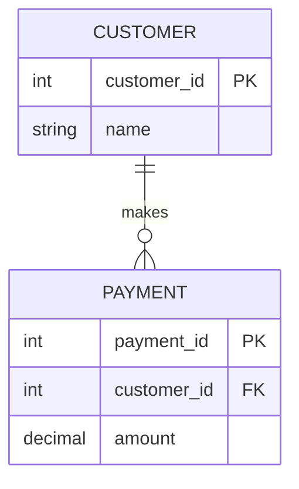

# Constraints, ER Modelling, FULL OUTER JOIN, HAVING vs WHERE & Foreign Keys (2024 Moed A)

> Part of: Databases & SQL
> **Databases & SQL Final Exam, Moed A (2024)**, course code 2455, Uri Goldstein. Bilingual (Hebrew and English), written answers, 5 questions of 20 points each (100 total).
> Key concepts: [[Constraint]], [[UNIQUE]], [[NOT NULL]], [[Entity-Relationship Model]], [[Entity]], [[Relationship]], [[FULL OUTER JOIN]], [[LEFT JOIN]], [[RIGHT JOIN]], [[UNION]], [[Aggregate Function]], [[GROUP BY]], [[HAVING]], [[WHERE]], [[Foreign Key]], [[Referential Integrity]], [[Index]]

> [!info] Answers from the instructor's answer file (unlabelled, treated as official).
> Every sub-question is answered in the file. Nothing in this note is AI-solved. The "Why" and "Tip" parts expand the official text; they never change an official answer.

## What this paper tests

This is a **short-answer theory paper**: no ERD to draw and no tables to join. The one insight that unlocks it is that every question is about *what a SQL feature is for and when it happens*, not about writing long queries.

| Question | Core idea | Points |
|---|---|---|
| Q1 | What a [[Constraint]] is, examples, and what it attaches to | 6 + 8 + 6 |
| Q2 | The 3-step design process: step 2 is [[Entity-Relationship Model\|Entity-Relationship Modelling]] | 6 + 6 + 8 |
| Q3 | [[FULL OUTER JOIN]] and how to emulate it in MySQL with [[UNION]] | 8 + 8 + 4 |
| Q4 | [[Aggregate Function]] in [[HAVING]] vs [[WHERE]], on the sakila database | 6 + 7 + 7 |
| Q5 | The three mechanisms of a [[Foreign Key]] | 6 + 6 + 8 |

---

## Q1 — Constraints [20 pts]

In SQL we learned the concept of a [[Constraint]].

### 1.1 Explain what a constraint is. (6 pts)

> [!success] Answer
> A constraint is a rule that dictates which values are allowed in a column or columns.

**Why.** The database enforces the rule automatically: an `INSERT` or `UPDATE` that would break it is rejected with an error. The rule is stated once, in the table definition, rather than checked by every application.

### 1.2 Give 2 examples of types of constraints and what they do. (8 pts)

> [!success] Answer
> - [[UNIQUE]]: dictates that no two values are the same in a column (or column combination) throughout the table.
> - [[NOT NULL]]: dictates that `NULL` values cannot be present in a column throughout the table.

```sql
CREATE TABLE customer (
    customer_id INT NOT NULL,
    email       VARCHAR(100) NOT NULL UNIQUE
);
```

> [!tip] Other valid examples
> Any two real constraint types earn the marks. `PRIMARY KEY`, `FOREIGN KEY`, `CHECK` and `DEFAULT` are the usual alternatives, but `UNIQUE` and `NOT NULL` are the ones in the official answer. Say *what the rule forbids*, not just the name.

### 1.3 To which part of a database are constraints applied? (6 pts)

> [!success] Answer
> A constraint can only be applied to one or more columns.

**Why.** Not to the whole database, not to a table as a unit, and not to a key. A multi-column constraint (for example `UNIQUE (first_name, last_name)`) is still a rule over a set of columns.

> [!warning] Exam trap
> The question offers "database, table, column, key" as options. The official answer is **column(s)** only. A table-level constraint clause is still just a rule on specific columns.

---

## Q2 — The three-step design process [20 pts]

In class we learned a 3-step process for designing and implementing data systems. Step 1 is gathering business requirements. Step 3 is building the database using SQL commands.

| Step | What happens |
|---|---|
| 1 | Gather business requirements |
| 2 | [[Entity-Relationship Model\|Entity-Relationship Modelling]] |
| 3 | Build the database in SQL |

### 2.1 What is the second step? (6 pts)

> [!success] Answer
> The second step is Entity-Relationship Modelling.

### 2.2 What is the main product (deliverable) of this step? (6 pts)

> [!success] Answer
> The deliverable is an Entity-Relationship Model that describes the distinct entities in the system and the relationships between them. It is often accompanied by an Entity-Relationship Diagram (ERD) that reflects this data visually.

The model is the deliverable; the diagram is the usual drawing of it.



> [!tip] Intuition
> The diagram above is only an illustration of "entities plus relationships", using sakila-style names. The exam did not ask for one.

### 2.3 Name and describe the two main elements of that product. (8 pts)

> [!success] Answer
> - **[[Entity|Entities]]** are distinct types of data that exist in the system.
> - **[[Relationship|Relationships]]** are the different ways in which specific pairs of entities relate to one another.

---

## Q3 — FULL OUTER JOIN [20 pts]

The following query is intended to perform a `FULL OUTER JOIN` between two tables:

```sql
SELECT *
FROM address FULL OUTER JOIN city
ON address.city_id = city.city_id;
```

In MySQL the query yields an **error**, because the expression `FULL OUTER JOIN` is not supported. A full outer join can be achieved in MySQL by combining two `SELECT` queries into one command.

### 3.1 Explain what a FULL OUTER JOIN is. (8 pts)

> [!success] Answer
> A full outer join is a horizontal joining of the contents of two tables where records from the left are matched to records on the right based on an `ON` clause. It also includes records on the left that have no match on the right, and vice versa. Records without matches show `NULL` values instead of matched values.

**In three buckets** (using `address` as left, `city` as right):

| Row type | In the result? | What the other side shows |
|---|---|---|
| Address matched to a city | Yes | Real values on both sides |
| Address with no matching city | Yes | `NULL` in the `city` columns |
| City with no matching address | Yes | `NULL` in the `address` columns |

An `INNER JOIN` keeps only the first bucket. A `LEFT JOIN` adds the second, a `RIGHT JOIN` adds the third. A `FULL OUTER JOIN` keeps all three.

### 3.2 What are the two SELECT queries combined to get a FULL OUTER JOIN in MySQL? (8 pts)

> [!success] Answer
> The two `SELECT` queries are a **left join** and a **right join**.

Written as code, based on the query above:

```sql
SELECT *
FROM address LEFT JOIN city
ON address.city_id = city.city_id

UNION

SELECT *
FROM address RIGHT JOIN city
ON address.city_id = city.city_id;
```

- The `LEFT JOIN` gives matched rows plus addresses with no city.
- The `RIGHT JOIN` gives matched rows plus cities with no address.
- Together they cover all three buckets above.

### 3.3 How are the two queries combined, and with which keyword? (4 pts)

> [!success] Answer
> They are combined with the `UNION` keyword, which also omits duplicate records.

**Why the duplicate removal matters.** The matched rows appear in *both* queries. `UNION` removes the duplicate copies, so each matched row shows once, as a true full outer join requires.

> [!warning] Exam trap
> `UNION ALL` keeps duplicates, so the matched rows would appear twice. For this purpose, `UNION` is the right keyword.

---

## Q4 — GROUP BY, HAVING and aggregate functions [20 pts]

The following query was written for the sakila database:

```sql
SELECT customer_id, AVG(amount)
FROM payment
GROUP BY customer_id
HAVING SUM(amount) > 100;
```

The question notes that the query uses one function in its `SELECT` clause and a *different* function in the clause that filters.

> [!note] Wording in the paper
> The intro says "WHERE clause", but the query's filter is actually in the `HAVING` clause. The official answers treat it as `HAVING`.

### 4.1 Explain in your own words what the query is intended to return. (6 pts)

> [!success] Answer
> The query returns a partial list of customers, identified by their ids, and for each one the average of the amounts across all payments they made. The list includes only customers whose sum of amounts is more than 100.

**Step by step:**

1. `GROUP BY customer_id` forms one group of payment rows per customer.
2. `SUM(amount)` is computed per group; groups with a sum of 100 or less are dropped by `HAVING`.
3. For the surviving groups, `SELECT` returns the `customer_id` and `AVG(amount)`.

### 4.2 Will the query run successfully or yield an error? Explain. (7 pts)

> [!success] Answer
> The query will run successfully. There is no syntactical dependency between the aggregate functions used in the `HAVING` clause and those used in the `SELECT` clause.

**Why.** `HAVING` and `SELECT` each work on the formed groups, so each may use any aggregate. The `HAVING` clause may use `SUM` while `SELECT` shows `AVG`; they do not need to match.

### 4.3 Would adding `WHERE MIN(amount) > 1.9` in its proper place yield an error? (7 pts)

Assume the query does not yield an error.

```sql
WHERE MIN(amount) > 1.9
```

> [!success] Answer
> Yes. Adding the `WHERE` clause will yield an error, because it uses an aggregate function at a point in the execution of the query when the groups from the `GROUP BY` clause have not been formed yet.

**Order of execution** (the reason behind the answer):

| Order | Clause | Groups exist yet? |
|---|---|---|
| 1 | `FROM` | No |
| 2 | `WHERE` | No, filters individual rows |
| 3 | `GROUP BY` | Groups formed here |
| 4 | `HAVING` | Yes, filters groups |
| 5 | `SELECT` | Yes |

An aggregate such as `MIN(amount)` needs a group to summarise, so it is legal in `HAVING` but not in `WHERE`.

> [!tip] Intuition
> `WHERE` filters rows *before* grouping. `HAVING` filters groups *after* grouping. To keep the intent of `MIN(amount) > 1.9` as a group filter, put it in `HAVING`:
>
> ```sql
> SELECT customer_id, AVG(amount)
> FROM payment
> GROUP BY customer_id
> HAVING SUM(amount) > 100
>    AND MIN(amount) > 1.9;
> ```

---

## Q5 — The three mechanisms of a FOREIGN KEY [20 pts]

A [[Foreign Key]] is a reference from a **child table** to a **parent table**. To implement one, three distinct mechanisms must be created in the child table. Complete the missing cells (the official answers are marked).

| Label | Name | Description | Points |
|---|---|---|---|
| A | **Column(s)** (official) | Contains values from the `PRIMARY KEY` of the parent table. | 6 |
| B | **Constraint** (official) | Ensures [[Referential Integrity]]: ensures there are no illegal values in A. | 6 |
| C | [[Index]] (key) | **Speeds up reading values from the column or columns. Important for when the column is used in JOINs.** (official) | 8 |

> [!success] Answer
> - **A:** Column(s)
> - **B:** Constraint
> - **C:** Description: speeds up reading values from the column or columns; important when the column is used in JOINs. (The Name cell, "Index (key)", is already printed in the paper's Hebrew column.)

**Why each one is needed:**

- **A (column)** holds the values that point at parent rows, for example `payment.customer_id` pointing at `customer.customer_id`.
- **B (constraint)** is the `FOREIGN KEY ... REFERENCES` rule. It rejects any value in A that does not exist in the parent's primary key.
- **C (index)** makes lookups on A fast, which matters because joins between child and parent run on exactly this column.

```sql
CREATE TABLE payment (
    payment_id  INT PRIMARY KEY,
    customer_id INT NOT NULL,                     -- A: the column
    amount      DECIMAL(5,2),
    INDEX idx_payment_customer (customer_id),     -- C: the index
    CONSTRAINT fk_payment_customer                -- B: the constraint
        FOREIGN KEY (customer_id)
        REFERENCES customer (customer_id)
);
```

> [!tip] Intuition
> Think of the three as: **what** (the column), **rule** (the constraint), **speed** (the index). In MySQL the foreign key constraint creates the index for you if you have not made one, but the exam treats it as a separate third mechanism.

---

## Recap table

| Q | Topic | One-line answer |
|---|---|---|
| 1.1 | What a constraint is | A rule dictating which values are allowed in a column or columns |
| 1.2 | Constraint examples | `UNIQUE` (no duplicates), `NOT NULL` (no nulls) |
| 1.3 | What constraints apply to | Only one or more columns |
| 2.1 | Step 2 of the process | Entity-Relationship Modelling |
| 2.2 | Deliverable | An Entity-Relationship Model, often drawn as an ERD |
| 2.3 | Two main elements | Entities and relationships |
| 3.1 | FULL OUTER JOIN | Matched rows plus unmatched rows from both sides, with `NULL` fill |
| 3.2 | Emulation in MySQL | A left join and a right join |
| 3.3 | Combining keyword | `UNION`, which also removes duplicates |
| 4.1 | Query meaning | Customers with total payments over 100, and their average payment |
| 4.2 | Runs? | Yes; `HAVING` and `SELECT` aggregates are independent |
| 4.3 | Add `WHERE MIN(...)`? | Error; `WHERE` runs before groups exist |
| 5.A | Foreign key column(s) | Holds values from the parent's primary key |
| 5.B | Constraint | Enforces referential integrity |
| 5.C | Index | Speeds up reading and joins on the column |

## Related notes

- Reading note on SQL keywords and exam tips (being written in parallel, not linked here).
