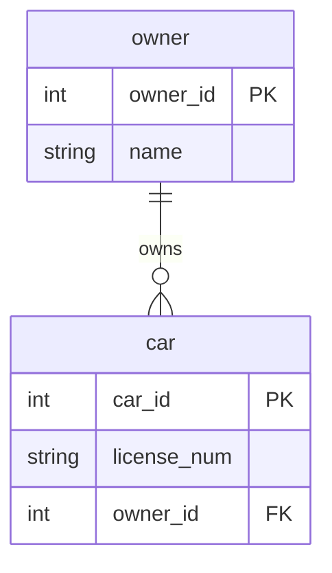
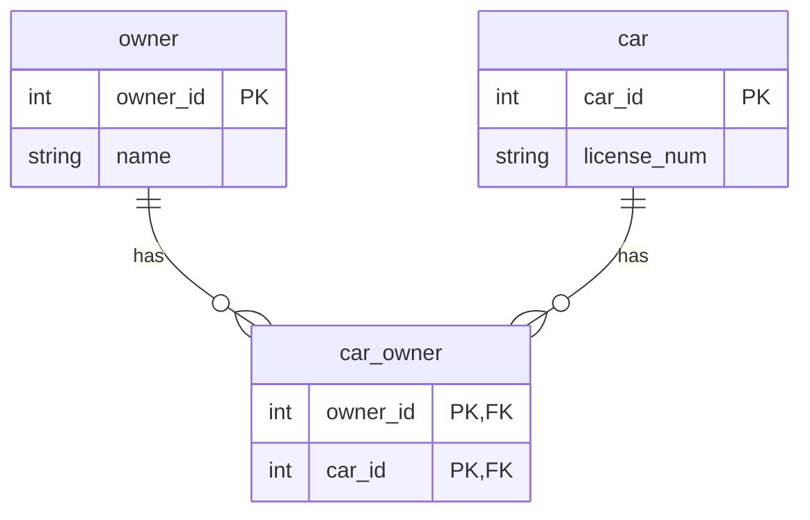

# One-to-Many Constraints, JOIN Row Counts, Constraint Types & GROUP BY Query (2024 Moed B)

> Part of: [[Databases & SQL]]
> **Databases & SQL Final Exam, Moed B (2024)**, Databases & SQL (course code 2455), Uri Goldstein. Written answers, bilingual Hebrew and English (English lines used here). 4 questions; the marks per sub-question are not shown in the answer file.
> Key concepts: [[One-to-Many Relationship]], [[Many-to-Many Relationship]], [[Foreign Key]], [[Primary Key]], [[NOT NULL Constraint]], [[UNIQUE Constraint]], [[Junction Table]], [[INNER JOIN]], [[LEFT JOIN]], [[RIGHT JOIN]], [[CROSS JOIN]], [[Referential Integrity]], [[GROUP BY]], [[HAVING]], [[Aggregate Function]]

> [!info] Answers from the instructor's answer file (unlabelled, treated as official).
> The answer file is signed by the instructor and includes grading notes (see Q4.4). Every answer below follows it; extra explanation and the odd check are mine and marked.

## What this paper tests

The exam is conceptual: no table has to be designed from scratch.

| Question | Topic | Core idea |
|---|---|---|
| Q1 | Changing the rules of a one-to-many relationship | Which cardinality rules a single constraint on the FK column can enforce |
| Q2 | Row counts of JOINs on tables of known size | CROSS JOIN is always `m x n`; INNER JOIN depends on the data; LEFT keeps every left row |
| Q3 | The six MySQL constraint types | What each does, and which two give referential integrity |
| Q4 | Reading a SELECT with LEFT/INNER JOIN, GROUP BY, HAVING | Output columns, row meaning, sort order, WHERE vs HAVING |

> [!tip] Intuition
> The one insight that unlocks Q1: in a one-to-many relationship the foreign key lives on the "many" side (`car.owner_id`). Every cardinality rule you can state about *a car's owner* is a rule about that one column, so a column constraint can enforce it. A rule about *an owner's cars* (at least one) is a rule about rows that may not exist yet, so a column constraint cannot.

---

## Q1 — One-to-many relationship: which changes can SQL enforce?

**Setup.** One owner can have many cars, so there is one foreign key from `car` to `owner`. Example data:

`car`

| car_id | license_num | owner_id |
|---|---|---|
| 101 | 11-111-11 | 1 |
| 102 | 22-222-22 | NULL |
| 103 | 33-333-33 | 1 |

`owner`

| owner_id | name |
|---|---|
| 1 | Alice |
| 2 | Bob |

- Alice owns two cars (101 and 103).
- Bob owns no cars.
- Car 102 has no owner.



Here an owner has zero or more cars, and a car has zero or one owner (the FK may be `NULL`).

Each of the four changes below is relative to **this example**, not to the other sub-questions. For each, say whether SQL can implement it, and if so which constraint goes on which column.

### 1.1 "Every car must have exactly one owner" (no car without an owner)

> [!success] Answer
> Yes. Apply a [[NOT NULL Constraint]] to the FK column, `owner_id` in the `car` table.

**Why.** The FK already guarantees that a car has *at most one* owner (one value per cell) and that the owner exists ([[Referential Integrity]]). The only gap is "at most one" versus "exactly one": the example allows `NULL` (car 102). Forbidding `NULL` closes that gap.

```sql
CREATE TABLE car (
    car_id INT PRIMARY KEY,
    license_num VARCHAR(20),
    owner_id INT NOT NULL,
    FOREIGN KEY (owner_id) REFERENCES owner (owner_id)
);
```

With this definition, row 102 (`owner_id` = `NULL`) could not be inserted.

### 1.2 "Every owner can have at most one car"

> [!success] Answer
> Yes. Apply a [[UNIQUE Constraint]] to the FK column, `owner_id` in the `car` table.

**Why.** A one-to-many relationship allows the same `owner_id` to repeat in `car` (Alice appears twice). `UNIQUE` forbids two rows with the same `owner_id`, so each owner appears at most once, which turns the relationship into one-to-one.

```sql
ALTER TABLE car
    ADD CONSTRAINT uq_car_owner UNIQUE (owner_id);
```

> [!warning] Check on the example data
> Cars 101 and 103 both have `owner_id` = 1, so this constraint could not be added to the example as it stands: one of them would first have to change. `NULL` values do not violate `UNIQUE` in MySQL (car 102 is fine).

### 1.3 "Every owner must have at least one car"

> [!success] Answer
> No. SQL has no construct that does this easily, and there is no sensible way to decide which car should be assigned to a newly inserted owner row.

**Why.** The constraint would have to hold for a row (an owner) in the table that does *not* hold the FK. An owner row is inserted first, and at that instant it has no car, so the rule is immediately violated. Cars can only point at owners that already exist, so there is a chicken-and-egg problem. A column constraint on `car.owner_id` cannot express it.

### 1.4 "A car can have multiple owners (0, 1 or more)"

> [!success] Answer
> The relationship becomes [[Many-to-Many Relationship]]. Add an intermediary table ([[Junction Table]]) with two foreign keys: one referencing `owner`, the other referencing `car`. (The existing FK in `car` need not be mentioned as removed.)



```sql
CREATE TABLE car_owner (
    owner_id INT,
    car_id INT,
    PRIMARY KEY (owner_id, car_id),
    FOREIGN KEY (owner_id) REFERENCES owner (owner_id),
    FOREIGN KEY (car_id) REFERENCES car (car_id)
);
```

> [!tip] Intuition
> A single FK column can hold only one value per row, so it can only point to one owner. Many owners per car needs many rows, so the links must live in their own table.
> Making the pair (`owner_id`, `car_id`) the primary key (my addition, not required by the key) stops the same owner being linked to the same car twice.

---

## Q2 — JOIN row counts: `fish` and `bicycle`

**Setup.** `fish` has a foreign key `bicycle_id` referencing `bicycle`. `fish` has **6** records, `bicycle` has **3**. The contents are unknown. Answer using only these facts.

### 2.1 What JOIN does this produce?

```sql
SELECT *
FROM fish
CROSS JOIN bicycle
    ON fish.bicycle_id = bicycle.bicycle_id;
```

> [!success] Answer
> An [[INNER JOIN]]. The query contains a valid `ON` clause, and in MySQL the `CROSS` keyword has no effect on execution.

**Why.** In MySQL, `JOIN`, `INNER JOIN` and `CROSS JOIN` are syntactic equivalents: with an `ON` condition they all behave as an inner join, and without one they all give the Cartesian product. The condition is what decides.

### 2.2 Can you tell the row count of a CROSS JOIN?

> [!success] Answer
> Yes: **18** rows. A [[CROSS JOIN]] pairs each of the 6 fish with each of the 3 bicycles: 6 x 3 = 18.

### 2.3 Can you tell the row count of an INNER JOIN?

> [!success] Answer
> No. The count depends on how many rows can be matched, which depends on the actual values in the FK and the PK. The question does not give those values.

> [!example] Why the range is wide
> - Every fish has a non-NULL `bicycle_id` that matches one of the 3 bicycles: 6 rows (each fish matches exactly one bicycle, because the bicycle PK is unique).
> - Every `bicycle_id` is `NULL`: 0 rows.
> - So anywhere from 0 to 6 rows is possible. (This range is my own working; the key only says the count cannot be determined.)

### 2.4 Do these two queries return the same number of rows?

```sql
-- Query A
SELECT *
FROM fish
LEFT JOIN bicycle USING (bicycle_id);

-- Query B
SELECT *
FROM bicycle
RIGHT JOIN fish USING (bicycle_id);
```

> [!success] Answer
> Yes. Both return **6** rows: one for each record in `fish`.

**Why.** Query B is Query A written the other way round: `bicycle RIGHT JOIN fish` keeps every row of the right table (`fish`), exactly as `fish LEFT JOIN bicycle` keeps every row of the left table (`fish`). Each fish matches at most one bicycle (the FK points to a unique PK), so no fish row is duplicated and none is lost. Only the column order differs.

> [!tip] Intuition
> LEFT and RIGHT JOIN are mirror images. To compare them, ask "which table is the preserved one?" In both queries it is `fish`.

---

## Q3 — The six MySQL 8.0 constraint types

### 3.1 What does each do when applied to a single column?

> [!success] Answer (official wording, condensed)

| Constraint | What it does on one column |
|---|---|
| [[Primary Key]] | Marks the column as the primary identifier of records in the table. Enforces uniqueness of its values and prevents `NULL`. |
| [[Foreign Key]] | Links records in this table to records in another table (by the other table's PK). Enforces [[Referential Integrity]]: values must come from the referenced table's PK. |
| [[Index]] (`KEY`) | Speeds up reading when the column is used for searching: in `WHERE`, `HAVING`, `ON`, `USING` or a `JOIN`. |
| [[UNIQUE Constraint]] | No two records may have the same value in the column. |
| [[NOT NULL Constraint]] | Prevents `NULL` values in the column. |
| [[CHECK Constraint]] | Requires every value in the column to satisfy a logical condition (predicate) defined in the constraint. |

> [!warning] Exam trap
> `KEY` / `INDEX` is the odd one out: it enforces no rule and changes no data validity. It only affects speed. `PRIMARY KEY` is effectively `UNIQUE` plus `NOT NULL` plus "this is the identifier".

### 3.2 Which constraints ensure referential integrity?

> [!success] Answer
> `PRIMARY KEY` and `FOREIGN KEY`.

**How they complement each other** (one sentence): the `PRIMARY KEY` guarantees that each row of the referenced table has a unique, never-NULL identifier, and the `FOREIGN KEY` guarantees that every value in the referencing column is one of those identifiers.

---

## Q4 — Reading a GROUP BY query

The query used in sub-questions 4.1, 4.5, 4.6, 4.7 and 4.8:

```sql
SELECT
    c.name,
    b.title,
    SUM(o.quantity) AS total_quantity
FROM customer AS c
    LEFT JOIN `order` AS o USING (customer_id)
    INNER JOIN book AS b USING (book_id)
WHERE b.genre = 'Science Fiction'
GROUP BY c.name, b.title
HAVING SUM(o.quantity) > 2
ORDER BY total_quantity DESC;
```

> [!note] Backticks
> `order` is a reserved word in SQL, so it must be written `` `order` `` as a table name. The paper prints it unquoted in the main query and quoted in 4.2 and 4.3. Treat this as a typesetting slip.

### 4.1 Which columns are returned, and what do they contain?

> [!success] Answer
> - `name`: the customer's name.
> - `title`: the title of the book.
> - `total_quantity`: the total number of copies of that book ordered by that customer.

### 4.2 Will an unmatched `customer` row appear?

```sql
SELECT *
FROM customer
LEFT JOIN `order` USING (customer_id);
```

> [!success] Answer
> Yes. In a [[LEFT JOIN]] every row of the left table is returned, both those with a matching row on the right and those without. The unmatched customer appears with `NULL` in all the `order` columns.

> [!warning] Typo in the key
> The key says "matched to a record on the left"; it means *on the right*. The conclusion is unaffected.

### 4.3 Will an unmatched `order` row appear?

```sql
SELECT *
FROM `order`
INNER JOIN `book` USING (customer_id);
```

> [!success] Answer
> No. An [[INNER JOIN]] returns only rows that have a match in the other table, so an order with no corresponding book row is dropped.

> [!warning] Check on the query as printed
> The query joins `order` and `book` `USING (customer_id)`, but the other queries join them through `book_id`. A `book` table normally has no `customer_id` column, in which case MySQL would reject the query. The key does not mention this and answers only the INNER JOIN concept, so keep the answer as given. (My check from the other queries in Q4; the schema is not shown in the paper.)

### 4.4 Can `b.genre` be added to the SELECT clause?

> [!success] Answer
> Yes, the query still runs. `genre` is not aggregated, but in this query it is fixed to one value by the `WHERE` clause (`'Science Fiction'`), so SQL knows what to show for it.

> [!info] Grading note from the key
> This was not covered in class, so **full points were given** to students who answered "no" (incorrectly) on the grounds that `genre` is not aggregated.

> [!tip] Intuition
> The usual rule is that every non-aggregated column in `SELECT` must appear in `GROUP BY` (otherwise MySQL's `ONLY_FULL_GROUP_BY` mode rejects the query). MySQL makes an exception when it can see that the column can only have one value in each group, which an equality to a constant in `WHERE` guarantees. For the exam, remember the rule; remember the exception only if asked.

### 4.5 What does each output row represent?

> [!success] Answer
> A unique combination of a customer and a book that the customer ordered at some point. Each row stands for the group of orders made by that specific customer of that specific book.

> [!tip] Intuition
> `GROUP BY c.name, b.title` collapses all order rows for the same (name, title) pair into one row, and `SUM(o.quantity)` adds up the copies in that group.
> Caveat (mine): grouping by `c.name` rather than `customer_id` would merge two different customers who share a name. The key does not raise this.

### 4.6 How is the output sorted?

> [!success] Answer
> By the number of copies ordered (`total_quantity`), descending: largest quantity first.

### 4.7 Why is `b.genre = 'Science Fiction'` in `WHERE` and not `HAVING`?

> [!success] Answer
> It tests "raw" values from one of the tables, so it must be evaluated **before** the `GROUP BY` step.

### 4.8 Why is `SUM(o.quantity) > 2` in `HAVING` and not `WHERE`?

> [!success] Answer
> It uses an [[Aggregate Function]], so it can only be evaluated **after** the `GROUP BY` step.

> [!example] Order of evaluation behind 4.7 and 4.8
> 1. `FROM` and `JOIN`: build the combined rows.
> 2. `WHERE`: drop rows that are not Science Fiction (row-level filter).
> 3. `GROUP BY`: collapse the remaining rows into one per (name, title).
> 4. `HAVING`: drop groups whose summed quantity is not greater than 2 (group-level filter).
> 5. `SELECT`: compute the output columns.
> 6. `ORDER BY`: sort the result.
>
> `WHERE` runs before groups exist, so it cannot see `SUM(...)`; `HAVING` runs after, so it filters groups.

> [!question] Why LEFT JOIN then INNER JOIN? (my observation)
> The `LEFT JOIN` to `order` keeps customers with no orders, but the following `INNER JOIN` to `book` (and the `WHERE` on `b.genre`) removes any row with no book, so customers without orders cannot reach the output anyway. The key does not comment on this.

---

## Recap table

| Part | Tool | One-line answer |
|---|---|---|
| 1.1 | [[NOT NULL Constraint]] | On `car.owner_id`: no car without an owner |
| 1.2 | [[UNIQUE Constraint]] | On `car.owner_id`: at most one car per owner |
| 1.3 | none | Not implementable: no easy construct, cannot pick a car for a new owner |
| 1.4 | [[Junction Table]] | Extra table with two FKs (many-to-many) |
| 2.1 | [[INNER JOIN]] | `CROSS` ignored in MySQL when `ON` is present |
| 2.2 | [[CROSS JOIN]] | 6 x 3 = 18 rows |
| 2.3 | [[INNER JOIN]] | Cannot know: depends on the FK and PK values |
| 2.4 | [[LEFT JOIN]] / [[RIGHT JOIN]] | Yes, both 6: one per fish |
| 3.1 | six constraints | PK, FK, KEY, UNIQUE, NOT NULL, CHECK as in the table |
| 3.2 | [[Referential Integrity]] | `PRIMARY KEY` and `FOREIGN KEY` |
| 4.1 | SELECT list | `name`, `title`, `total_quantity` |
| 4.2 | [[LEFT JOIN]] | Unmatched customer appears (with NULLs) |
| 4.3 | [[INNER JOIN]] | Unmatched order does not appear |
| 4.4 | [[GROUP BY]] | Runs: `genre` is pinned by `WHERE` (full points for "no") |
| 4.5 | [[GROUP BY]] | One row per (customer, book) pair |
| 4.6 | ORDER BY | `total_quantity` descending |
| 4.7 | WHERE | Raw-value filter, runs before grouping |
| 4.8 | [[HAVING]] | Aggregate filter, runs after grouping |

## Related Notes

- Hub: [[Databases & SQL]]
