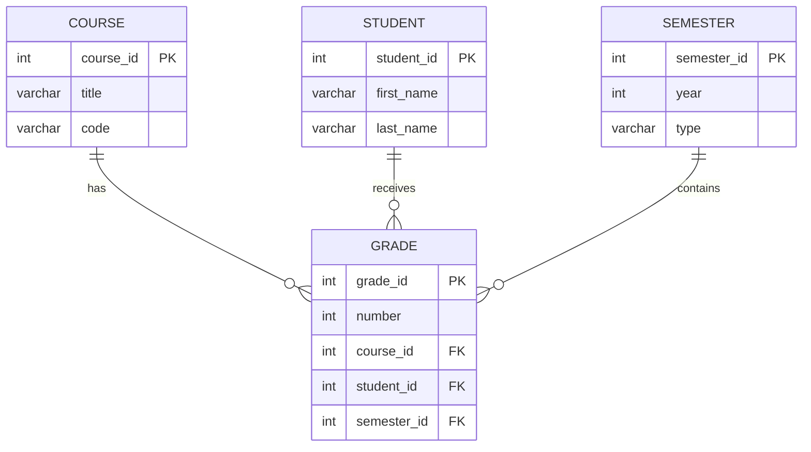
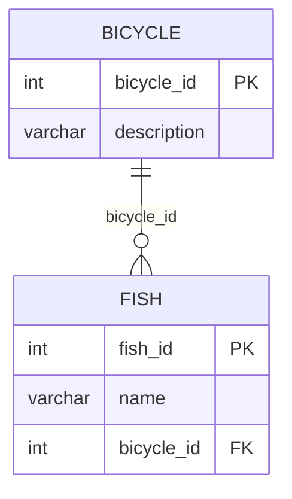

# Databases & SQL: 2024 Moed A (course code 3437)

> **Course:** [[Databases & SQL]], Uri Goldstein. Written exam, 5 questions at 20 points each (100 total). Bilingual paper; this note follows the English lines.
> **Which paper is this?** There is another 2024 Moed A in this course (PP_01), but that one has course code **2455**. This one is **3437**.
> **Key concepts:** [[Entity-Relationship Diagram]], [[Foreign Key]], [[Primary Key]], [[UNIQUE Constraint]], [[NOT NULL Constraint]], [[CHECK Constraint]], [[CROSS JOIN]], [[INNER JOIN]], [[LEFT JOIN]], [[FULL OUTER JOIN]], [[Referential Integrity]], [[Index]], [[GROUP BY]], [[HAVING]], [[AUTO_INCREMENT]], [[DEFAULT Constraint]]

> [!info] Answers from the instructor's answer file (unlabelled, treated as official).
> Question text and the answers are in the same PDF, signed "Uri". All five questions have an answer, so nothing here is AI-solved. Where I add something beyond the key (a count, a bound, a MySQL note) it is marked as an extension.

> [!warning] Two typos in the key
> - Q2.1 says "CORSS JOIN". Corrected here to **CROSS JOIN**.
> - Q5.1 fills the title as `Dr` although the statement inserts `'Dr.'`. The stored value is `Dr.` (with the full stop); the key's `Dr` is a typo.

## What this paper tests

| Q | Topic | Pts |
|---|---|---|
| 1 | Turning an ERD into tables, FKs, and column constraints (UNIQUE, NOT NULL, CHECK) | 20 |
| 2 | How many rows each JOIN type returns, given only table sizes (6 and 3) | 20 |
| 3 | The three mechanisms behind a foreign key; joining without the constraint | 20 |
| 4 | Reading a query: JOIN type, relationship type, WHERE vs GROUP BY vs HAVING | 20 |
| 5 | Which INSERTs succeed given NOT NULL, DEFAULT and AUTO_INCREMENT | 20 |

> [!tip] Intuition
> The unlocking idea for the whole paper: **constraints and keys decide what a table will accept, and JOIN type decides what a query will return.** Most answers come from asking "which rows are guaranteed to exist?" (Q2) or "which rule is the database enforcing?" (Q1, Q3, Q5).

---

## Q1: ERD to relational tables [20 pts]

**Question.** Examine the ER diagram below. It describes 4 entities. It can be said that the "grade" entity represents a many-to-many-to-many relationship between the other 3 entities. Imagine you are tasked with implementing the ERD as a relational (SQL-based) database.

The paper's own diagram (real data, cropped from the exam):

![[PP03_q1_source_erd.png|560]]

Course, Student and Semester each have a one-to-many link to Grade (one course, student or semester can have many grades; each grade belongs to exactly one of each). Redrawn as a logical ERD with the keys the answer implies (the `id` columns are my naming, not in the paper):



### 1.1 Number of tables [5 pts]

> [!success] Answer
> **4 tables**, one per entity: `student`, `course`, `semester`, `grade`.

**Why.** Each entity becomes a table. The "many-to-many-to-many" `grade` entity is already a junction (link) entity: it is a real table that holds the grade value *and* the links to the other three, so no extra table is needed.

### 1.2 Foreign keys [5 pts]

> [!success] Answer
> **3 foreign keys**, all in the `grade` table:
> - `grade` to `student`
> - `grade` to `course`
> - `grade` to `semester`

**Why.** A foreign key always lives on the "many" side of a one-to-many relationship, pointing at the "one" side. `grade` is the many side for all three relationships, so all three FKs sit in `grade`. See [[Foreign Key]] and [[Primary Key]].

### 1.3 Every course has a different code [3 pts]

> [!success] Answer
> Add a **UNIQUE** constraint on the `code` column of the `course` table. It prevents any value from appearing in more than one record of that column.

```sql
ALTER TABLE course
ADD CONSTRAINT uq_course_code UNIQUE (code);
```

(The `ALTER` form and constraint name are my illustration; the key only names the constraint.) See [[UNIQUE Constraint]].

### 1.4 A grade must have a numeric value [3 pts]

> [!success] Answer
> Apply a **NOT NULL** constraint to the `number` column of the `grade` table. It prevents NULL values (unknown) from being entered into the column.

```sql
number INT NOT NULL
```

See [[NOT NULL Constraint]].

### 1.5 The grade must be between 0 and 100 [4 pts]

> [!success] Answer
> Add a **CHECK** constraint on `number` in the `grade` table:

```sql
CHECK (number BETWEEN 0 AND 100)
```

> The constraint prevents values that do not satisfy its predicate from entering the column.

> [!warning] Trap
> NOT NULL alone does not limit the range, and a CHECK alone would still let NULL in (a CHECK passes when the predicate is unknown). That is why 1.4 and 1.5 are separate requirements needing two constraints. See [[CHECK Constraint]].

---

## Q2: JOIN row counts from table sizes [20 pts]

**Question.** A MySQL database has two tables, `fish` and `bicycle`. The `fish` table contains a foreign key pointing to `bicycle`. `fish` has 6 records and `bicycle` has 3 records; the exact contents are not given. Using only this, answer the questions about JOINs with `fish` on the **left** and `bicycle` on the **right**.

![[PP03_q2_source_fish_bicycle_tables.png|560]]



### 2.1 What JOIN does this query output? [5 pts]

```sql
SELECT *
FROM fish
INNER JOIN bicycle;
```

> [!success] Answer
> A **CROSS JOIN**, because the query has no `ON` clause and no `USING` clause, and the `INNER` keyword has no real effect on the result.

> [!note] Typo fixed
> The key spells it "CORSS JOIN". It means CROSS JOIN.

**Working (extension, not in the key).** A CROSS JOIN pairs every left row with every right row, so it returns 6 x 3 = **18 rows**.

> [!tip] Intuition
> `INNER JOIN` is supposed to filter to matching pairs, but with no condition there is nothing to match on, so nothing is filtered. In MySQL a JOIN without a condition is legal and behaves as a cross join. See [[CROSS JOIN]] and [[INNER JOIN]].

### 2.2 Row count of a LEFT JOIN [5 pts]

> [!success] Answer
> **6.** A LEFT JOIN outputs a record for every row of the left table, and the left table is `fish` (6 records).

**Working.** Each of the 6 fish appears at least once. If a fish has no matching bicycle, it appears once with NULLs on the bicycle side. Because `bicycle_id` is the primary key of `bicycle`, a fish can match at most one bicycle, so no fish is duplicated. Result: exactly 6.

> [!warning] Why it can be known
> It works only because the join is on the FK to the PK (at most one match per fish). If the right side could match a fish several times, the count could exceed 6. See [[LEFT JOIN]].

### 2.3 Row count of an INNER JOIN [5 pts]

> [!success] Answer
> **Cannot be known.** An INNER JOIN returns only records that have a match on the other side, and the number of matches is not given.

**Extension (my bound, not in the key).** Since the FK points to a PK, each fish matches at most one bicycle, so the count lies between 0 and 6. If fish had `bicycle_id` NULL or unmatched, they drop out. Not enough to give one number.

### 2.4 Row count of a FULL OUTER JOIN [5 pts]

> [!success] Answer
> **Cannot be known.** The row count depends on how many records on each side match, and this is not given.

**Extension (my bound, not in the key).** Let `m` be the matched fish. Output = matched rows + unmatched fish + unmatched bicycles = `m` + (6 - `m`) + (unmatched bicycles, from 0 to 3) = **6 to 9** rows. Still a range, not a number.

> [!tip] MySQL note
> MySQL has no `FULL OUTER JOIN` keyword; it is emulated with `LEFT JOIN ... UNION ... RIGHT JOIN`. The question treats it conceptually. See [[FULL OUTER JOIN]].

| JOIN | Count | Known? | Reason |
|---|---|---|---|
| CROSS (no ON) | 18 | Yes (extension) | 6 x 3, every pair |
| LEFT | 6 | Yes | all left rows kept |
| INNER | 0 to 6 | No | matches not given |
| FULL OUTER | 6 to 9 | No | matches not given |

---

## Q3: The three mechanisms of a foreign key [20 pts]

**Question.** A FOREIGN KEY is a link from a CHILD TABLE to a PARENT TABLE. To implement it the child table must contain 3 different things (database mechanisms).

### 3.1 Complete the table [15 pts]

> [!success] Answer
> | | Name | Role | Points |
> |---|---|---|---|
> | A | **COLUMN** | Contains values that link to the parent table's primary key. | 5 |
> | B | **CONSTRAINT** | Ensures column values come from the parent table's PK (**REFERENTIAL INTEGRITY**). | 5 |
> | C | **INDEX (KEY)** | Speeds up querying data by the column, and as a result speeds up JOIN operations based on it. | 5 |

(The filled-in cells were the blank ones in the exam: the names for A, B, C, and the description for C.)

**Why three.** The column stores the link, the constraint stops bad links, the index makes the link fast to follow. In MySQL, defining a FOREIGN KEY constraint creates the index automatically if none exists. See [[Foreign Key]], [[Referential Integrity]], [[Index]].

### 3.2 Join on an FK column without the constraint? [5 pts]

> [!success] Answer
> **Yes**, it is possible to JOIN on the FK column. But without the constraint, mistakes can occur in the output because of values in the column that are not present in the parent table's PK.

> [!tip] Intuition
> A JOIN only compares values; it does not care whether a constraint exists. Without the constraint, "orphan" values can exist (a `bicycle_id` of 99 with no bicycle 99), so an INNER JOIN silently drops those rows and results become misleading.

---

## Q4: Reading a query [20 pts]

```sql
SELECT
    dept_name,
    COUNT(employee_id) AS num_of_employees
FROM employee
JOIN department USING (dept_id)
WHERE hire_date >= '2024-01-01'
GROUP BY dept_name
HAVING COUNT(employee_id) > 5
ORDER BY num_of_employees DESC;
```

### 4.1 What does the query return? [5 pts]

> [!success] Answer
> A list of departments and the number of employees in each, counting only employees hired this year (2024), and only departments with more than 5 such employees. Output is sorted by the number of employees, highest to lowest.

> [!warning] Order of evaluation
> `WHERE` runs first, so the count is of *2024 hires*, not all staff. A department with 20 staff but only 3 hired in 2024 is excluded by `HAVING`.

### Unnumbered part: which JOIN type? [4 pts]

> [!success] Answer
> **INNER JOIN.** The keyword `JOIN` appears without `LEFT` or `RIGHT`, and a `USING` clause is present.

Plain `JOIN` is shorthand for `INNER JOIN`. `USING (dept_id)` supplies the join condition and appears once in the output.

### 4.2 Relationship type between the tables [5 pts]

> [!success] Answer
> **One-to-many** (each department has several employees). Many-to-many is ruled out because only 2 tables are involved (it would need a third, junction, table). One-to-one is ruled out because each output record represents a group of several records from `employee`.

> [!note] Numbering
> In the paper the JOIN-type question (4 pts) has no number of its own and sits between 4.1 and 4.2. Marks: 5 + 4 + 5 + 6 = 20.

### 4.3 Role of WHERE, GROUP BY, HAVING [6 pts]

> [!success] Answer
> - **WHERE** filters records based on **raw data** (employee hire dates).
> - **GROUP BY** groups raw records into grouped data based on one or more columns (department / `dept_name`).
> - **HAVING** filters records based on **grouped data** (the number of employees in each group).

| Clause | Acts on | Here |
|---|---|---|
| `WHERE` | individual rows, before grouping | `hire_date >= '2024-01-01'` |
| `GROUP BY` | builds the groups | one group per `dept_name` |
| `HAVING` | whole groups, after grouping | `COUNT(employee_id) > 5` |

> [!tip] Intuition
> Aggregates like `COUNT` do not exist yet when `WHERE` runs, so conditions on them must go in `HAVING`. See [[GROUP BY]], [[HAVING]].

---

## Q5: Will the INSERT succeed? [20 pts, 5 each]

Each command is independent and the table is empty and reset before each one.

```sql
CREATE TABLE author (
    author_id INT PRIMARY KEY AUTO_INCREMENT,
    title VARCHAR(32) NOT NULL DEFAULT '',
    first_name VARCHAR(256),
    last_name VARCHAR(256) NOT NULL
);
```

| Column | Rule when no value is given |
|---|---|
| `author_id` | `AUTO_INCREMENT` generates 1, 2, ... |
| `title` | `NOT NULL` but has `DEFAULT ''`, so the empty string is used |
| `first_name` | nullable with no default, so NULL |
| `last_name` | `NOT NULL` with **no** default, so it is mandatory |

### 5.1 [5 pts]

```sql
INSERT INTO `author` (author_id, title, first_name, last_name)
VALUES (1, 'Dr.', 'Phil', 'Good');
```

> [!success] Answer: succeeds
> | author_id | title | first_name | last_name |
> |---|---|---|---|
> | 1 | Dr. | Phil | Good |

All four values are supplied, so nothing is generated or defaulted. (The key prints `Dr`; that is a typo, see the warning at the top.)

### 5.2 [5 pts]

```sql
INSERT INTO `author` (first_name, last_name)
VALUES ('Foo', 'Bar');
```

> [!success] Answer: succeeds
> | author_id | title | first_name | last_name |
> |---|---|---|---|
> | 1 | (empty string) | Foo | Bar |

`author_id` is auto-generated (1 on an empty table) and `title` takes its DEFAULT, the empty string `''` (not NULL).

### 5.3 [5 pts]

```sql
INSERT INTO `author` (title, last_name)
VALUES ('Mr.', 'Smoketoomuch');
```

> [!success] Answer: succeeds
> | author_id | title | first_name | last_name |
> |---|---|---|---|
> | 1 | Mr. | NULL | Smoketoomuch |

`first_name` is nullable and has no default, so it becomes NULL.

### 5.4 [5 pts]

```sql
INSERT INTO `author` (title, first_name)
VALUES ('Dame', 'Edna');
```

> [!success] Answer: fails
> Execution fails with an error because no value was given for `last_name`, which has a NOT NULL constraint and no DEFAULT constraint to supply a value.

> [!tip] Intuition
> `title` is also NOT NULL, but it is safe because it has a DEFAULT. `last_name` is the only column that is both NOT NULL and default-less, so it is the only one you can forget.

See [[NOT NULL Constraint]], [[DEFAULT Constraint]], [[AUTO_INCREMENT]].

---

## Recap

| Q | Tool | One-line answer |
|---|---|---|
| 1.1 | Entity to table | 4 tables: student, course, semester, grade |
| 1.2 | Foreign key | 3 FKs, all in `grade` |
| 1.3 | UNIQUE | on `course.code` |
| 1.4 | NOT NULL | on `grade.number` |
| 1.5 | CHECK | `number BETWEEN 0 AND 100` |
| 2.1 | CROSS JOIN | no ON/USING, so every pair (18 rows) |
| 2.2 | LEFT JOIN | 6, all left rows |
| 2.3 | INNER JOIN | unknown, matches not given |
| 2.4 | FULL OUTER JOIN | unknown, matches not given |
| 3.1 | FK mechanisms | column, constraint (referential integrity), index |
| 3.2 | JOIN without constraint | possible, but orphan values can mislead |
| 4.1 | Query reading | departments with more than 5 hires in 2024, count, descending |
| 4 (unnumbered) | JOIN type | INNER (plain JOIN plus USING) |
| 4.2 | Relationship | one-to-many |
| 4.3 | Clauses | WHERE raw rows, GROUP BY groups, HAVING groups |
| 5.1 | INSERT | succeeds, all values given |
| 5.2 | INSERT | succeeds, id 1, title '' |
| 5.3 | INSERT | succeeds, first_name NULL |
| 5.4 | INSERT | fails, `last_name` NOT NULL, no default |

## Related notes

- [[Databases & SQL]] (course hub)
