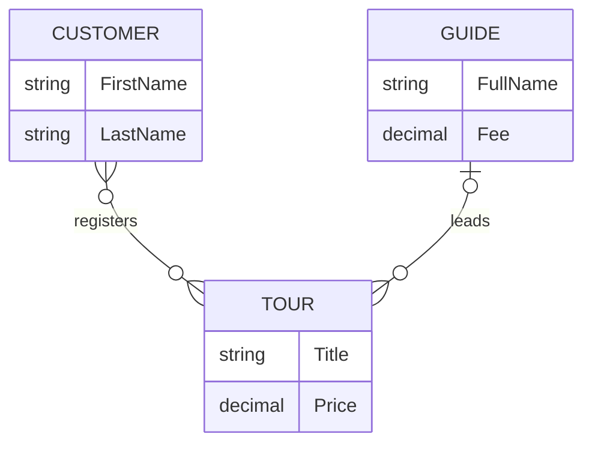
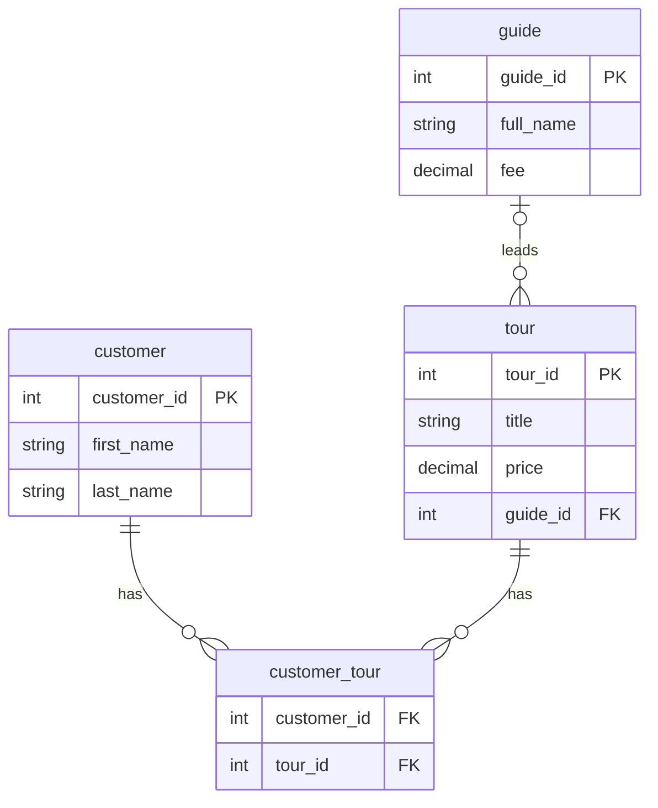

# Join Counts, Tour ERD, Constraints & Many-to-Many Keys (Moed B, undated)

> Part of: [[Databases & SQL]]
> **Databases & SQL Exam, Moed B (undated)**, course code 3437, Uri Goldstein. Six questions, 100 points, written answers, bilingual paper (English lines used here).
> Key concepts: [[Left Join]], [[Inner Join]], [[Group By]], [[Having]], [[Entity-Relationship Diagram]], [[Junction Table]], [[Foreign Key]], [[Unique Constraint]], [[Check Constraint]], [[Referential Integrity]], [[Null]]

> [!info] Answers from the instructor's answer file (unlabelled, treated as official).
> The PDF is 20 pages: question and the instructor's answer share the same file, signed "Uri". The paper is undated; the PDF metadata date is 2025-02-02. Every question here is `official`; nothing is AI-solved.

> [!note] Exam instructions (from the paper)
> Keep answers short and to the point. Unless stated otherwise, sub-questions do not depend on each other.

## What this paper tests

| Question | Pts | Core idea | Key concept |
|---|---|---|---|
| Q1 | 20 | Reading a two-`LEFT JOIN` aggregate query: row count, why outer joins, grouping key, filtering on an aggregate | [[Left Join]], [[Group By]], [[Having]] |
| Q2 | 20 | Turning a [[Entity-Relationship Diagram]] into tables and keys, then adding NOT NULL, UNIQUE and CHECK requirements | [[Junction Table]], [[Foreign Key]], [[Check Constraint]] |
| Q3 | 20 | When can you know the row count of a join from limited facts? | [[Cross Join]], [[Inner Join]], [[Full Outer Join]] |
| Q4 | 20 | Five short theory questions: index cost, DEFAULT, FK vs referential integrity, DISTINCT vs UNIQUE, NULL | [[Index]], [[Default Constraint]], [[Distinct]] |
| Q5 | 5 | Do an `INNER JOIN` and a scalar subquery give the same result? | [[Null]], [[Left Join]] |
| Q6 | 15 | Composite vs surrogate primary key on a many-to-many table | [[Composite Primary Key]], [[Surrogate Key]], [[Cardinality]] |

> [!tip] Intuition
> Almost every answer on this paper comes from one habit: ask "which rows survive, and which rows can be NULL?" Outer joins keep unmatched rows, `NOT NULL` and `UNIQUE` stop bad rows from entering, and a join count can only be known if the facts given pin down the table that drives it.

---

## Q1 — Reading a LEFT JOIN query (20 pts)

Examine this query and answer the questions that follow.

```sql
SELECT
    p.ProductName,
    COUNT(o.OrderID) AS OrderCount
FROM Products p
LEFT JOIN OrderDetails od
    ON p.ProductID = od.ProductID
LEFT JOIN Orders o
    ON od.OrderID = o.OrderID
GROUP BY p.ProductID
ORDER BY OrderCount DESC;
```

### 1.1 Output size (5 pts)

Given that `Products` has 5 records, `OrderDetails` has 10 and `Orders` has 5, is it possible to know how many records the output has? If yes, how many, and show the calculation. If not, explain why.

> [!success] Answer
> **Yes: 5 records.**

- The first `LEFT JOIN` returns at least every row on its left side, so all 5 `Products` rows are kept (a product with several order details appears several times, but never fewer than once).
- The second `LEFT JOIN` has that result as its left side, so it again keeps every one of those rows.
- The query then groups by the `Products` primary key. There are 5 distinct products, so there are **5 groups**, and `GROUP BY` returns one row per group: **5 output rows**.

> [!example] Working
> The intermediate row count (anything from 5 up to 10 or so) is not known and does not matter. What fixes the answer is the grouping key: one group per product, five products, five rows.

### 1.2 Why LEFT JOINs? (5 pts)

> [!success] Answer
> The `LEFT JOIN`s make sure even records with no match on the right are still included. Products with no order details, or no orders, are shown with an order count of 0. With `INNER JOIN`s those products would be dropped from the output.

> [!example] Why the count becomes 0 and not 1
> For an unmatched product the right-hand columns are `NULL`. `COUNT(o.OrderID)` counts only non-NULL values, so it returns 0. (`COUNT(*)` would wrongly return 1 for such a product, because the unmatched row itself still exists.)

### 1.3 GROUP BY name instead of ID (5 pts)

If the query grouped by `p.ProductName` instead of `p.ProductID`, why might this be less desirable?

> [!success] Answer
> `ProductName` might not be unique, so counts of different products that share a name would be merged into one group. `ProductID` (assumed to be the primary key) is guaranteed unique.

### 1.4 Showing only products with OrderCount greater than 4 (5 pts)

> [!success] Answer
> Add a `HAVING` clause, because `OrderCount` is computed with an aggregate function and can only be tested after grouping.

```sql
SELECT
    p.ProductName,
    COUNT(o.OrderID) AS OrderCount
FROM Products p
LEFT JOIN OrderDetails od
    ON p.ProductID = od.ProductID
LEFT JOIN Orders o
    ON od.OrderID = o.OrderID
GROUP BY p.ProductID
HAVING OrderCount > 4
ORDER BY OrderCount DESC;
```

> [!warning] Exam trap
> `WHERE` runs before grouping, so it cannot see `COUNT(...)`. Use `WHERE` for conditions on individual rows and `HAVING` for conditions on groups. The full query above is my illustration; the official answer only names the clause. (Using the alias `OrderCount` in `HAVING` works in MySQL.)

---

## Q2 — From ERD to tables and constraints (20 pts)

The ERD describes three entities, `Customer` (attributes `FirstName`, `LastName`), `Tour` (`Title`, `Price`) and `Guide` (`FullName`, `Fee`).

- A customer can register for 0 or more guided tours. A tour can have 0 or more customers registered for it.
- Every tour can have 0 or 1 guides assigned to it. Every guide must have at least one, possibly more, tours assigned to them.

Imagine implementing the ERD as a relational (SQL) database.

> [!note] The paper's ERD, redrawn from its description
> The paper shows a box diagram with crow's feet; this version follows the text of the question, with the Customer-Tour relationship drawn as many-to-many and Tour-Guide as many tours to at most one guide.



### 2.1 How many tables? (4 pts)

> [!success] Answer
> **4 tables**: `customer`, `tour` and `guide` (one per entity) plus a fourth table implementing the many-to-many relationship between customer and tour, named for example `customer_tour` or `registration`.

A [[Many-to-Many Relationship]] cannot be stored with a single foreign key on either side, so it needs a [[Junction Table]] whose rows are the individual pairings.

### 2.2 How many foreign keys? (4 pts)

> [!success] Answer
> **3 foreign keys**:
> - `customer_tour` to `customer`
> - `customer_tour` to `tour`
> - `tour` to `guide`



> [!tip] Intuition
> The foreign key always goes on the "many" side of a one-to-many link. One guide leads many tours, so `guide_id` sits in `tour`. The many-to-many link has no "many" side to hold it, so both keys sit in the new table.

> [!warning] Not enforceable with an FK alone
> The paper also says every guide must have at least one tour. A foreign key cannot force that (it only constrains tours, not guides), and the answer file does not ask for it. Treat it as a business rule outside the schema.

### 2.3 Every tour must have exactly one guide (4 pts)

> [!success] Answer
> Add a `NOT NULL` constraint to the foreign key column in `tour` that points to `guide`. That guarantees at least one guide, and since a tour could already have at most one guide, it becomes exactly one.

```sql
ALTER TABLE tour
    MODIFY guide_id INT NOT NULL;
```

(The statement is my illustration; the official answer names the constraint only.)

### 2.4 Tour titles must all differ (4 pts)

> [!success] Answer
> Add a `UNIQUE` constraint to the `Title` column. No two tours can then share a title.

```sql
ALTER TABLE tour
    ADD CONSTRAINT uq_tour_title UNIQUE (title);
```

### 2.5 Guide fee must be positive or zero (4 pts)

> [!success] Answer
> Either define the `Fee` column as `UNSIGNED`, or add a `CHECK` constraint containing the predicate `Fee >= 0`.

- `UNSIGNED` means the number has no minus sign, so negative values cannot be stored.
- The `CHECK` constraint rejects any `INSERT` or `UPDATE` where the predicate is not true.

```sql
ALTER TABLE guide
    ADD CONSTRAINT chk_guide_fee CHECK (fee >= 0);
```

> [!note] Wording
> The question text says "positive number, or 0" while the official answer uses `>= 0`; the answer is kept as given.

---

## Q3 — Join row counts: fish and bicycle (20 pts)

Two tables in MySQL:

| fish column | type | constraint |
|---|---|---|
| fish_id | INT | PK |
| name | VARCHAR(10) | |
| bicycle_id | INT | FK to `bicycle.bicycle_id` |

| bicycle column | type | constraint |
|---|---|---|
| bicycle_id | INT | PK |
| description | VARCHAR(64) | |

**Given:** 7 of the `fish` records are linked to 4 of the `bicycle` records. It is not known how many records each table has in total.

For each join type, can you know how many rows the output has? If yes, give the number and the calculation. If not, explain why. In the LEFT and RIGHT cases `fish` is on the left and `bicycle` on the right.

> [!tip] Intuition
> Ask which table drives the join. `CROSS JOIN` needs both table sizes, `LEFT JOIN` needs the left size, `RIGHT JOIN` the right size, `FULL OUTER JOIN` both sizes plus the match count. Only `INNER JOIN` depends on the matched rows alone, and that is the only thing given.

### 3.1 CROSS JOIN (4 pts)

> [!success] Answer
> **Not possible to tell.** A `CROSS JOIN` returns (rows in `fish`) times (rows in `bicycle`), and neither total is given.

### 3.2 LEFT JOIN, fish left (4 pts)

> [!success] Answer
> **Not possible to tell.** A `LEFT JOIN` keeps every row of the left table, so the count depends directly on the number of `fish` rows, which is not given (there may be unlinked fish with `NULL` in `bicycle_id`).

### 3.3 RIGHT JOIN, bicycle right (4 pts)

> [!success] Answer
> **Not possible to tell.** A `RIGHT JOIN` keeps every row of the right table, so the count depends directly on the number of `bicycle` rows, which is not given (there may be bicycles no fish points to).

### 3.4 INNER JOIN (4 pts)

> [!success] Answer
> **7 rows.**

Each `fish` row has at most one bicycle, because its foreign key holds a single value pointing at one primary key. An `INNER JOIN` returns one row per matching pair. All 7 linked fish match, giving 7 pairs. The 4 bicycles are "covered" by those 7 fish: they are reused (several fish can share one bicycle) and add no extra rows.

> [!example] Working
> 7 linked fish, each matching exactly one bicycle, gives 7 rows. The count of 4 bicycles tells you how often bicycles repeat, not how many rows appear.

### 3.5 FULL OUTER JOIN (4 pts)

> [!success] Answer
> **Not possible to tell.** A `FULL OUTER JOIN` returns the matched rows plus the unmatched rows from both sides, so the count depends on the totals of both tables, which are not given.

> [!example] Why "not known" (my illustration)
> Take 7 fish linked to 4 bicycles. If both tables hold only those rows, `LEFT JOIN` gives 7. Add 3 unlinked fish and `LEFT JOIN` gives 10. Both situations fit the facts given, so no single number is possible.

---

## Q4 — Short theory questions (20 pts)

### 4.1 Cost of an index (4 pts)

> [!success] Answer
> An index slows down writing to the column. It has to be refreshed (updated) every time a value is changed.

> [!tip] Intuition
> An [[Index]] is a second, sorted copy of the column. Reads get faster because the lookup is sorted, but every `INSERT`, `UPDATE` or `DELETE` must also keep that copy in order.

### 4.2 DEFAULT vs the other constraints (4 pts)

> [!success] Answer
> The other constraints may make an `INSERT` or `UPDATE` fail on "bad" input. A [[Default Constraint]] instead "fixes" the missing data by supplying a default value in its place.

### 4.3 Foreign key constraint and referential integrity (4 pts)

> [!success] Answer
> A foreign key constraint **enforces** [[Referential Integrity]]: it prevents bad references (foreign key values with no matching parent row) from existing in the database.

### 4.4 DISTINCT vs UNIQUE (4 pts)

> [!success] Answer
> - `DISTINCT` is used in `SELECT` queries (DML) to remove duplicate values from the result.
> - `UNIQUE` is used in the `CREATE` / `UPDATE TABLE` commands (DDL) so that duplicate values cannot be entered into a column (or a combination of columns).

> [!warning] Wording
> The official text writes "CREATE/UPDATE TABLE"; the DDL command that changes an existing table is `ALTER TABLE`, so read "UPDATE TABLE" as `ALTER TABLE`. The answer is otherwise kept as given.

```sql
SELECT DISTINCT country_id
FROM city;
```

```sql
CREATE TABLE country (
    country_id INT PRIMARY KEY,
    country    VARCHAR(50) UNIQUE
);
```

(The two examples are mine.)

### 4.5 A problem solved by the invention of NULL (4 pts)

> [!success] Answer
> Before [[Null]] existed, different users invented their own notation for a missing value: for numbers, some used 0, others -1, others -99999. This inconsistency caused mistakes when data was processed. Standardising on `NULL` solved it.

---

## Q5 — Same result? INNER JOIN vs scalar subquery (5 pts)

Will these two queries yield the same result?

```sql
SELECT
    city.city,
    country.country
FROM city
INNER JOIN country
    USING (country_id)
ORDER BY city, country;
```

```sql
SELECT
    city.city,
    (SELECT country
     FROM country
     WHERE country.country_id = city.country_id) AS country
FROM city
ORDER BY city, country;
```

> [!success] Answer
> **Not necessarily.** If some `city` rows have a `NULL` `country_id`, those rows appear in the second query (with `NULL` as the country) but are omitted from the first. The second query is equivalent to a `LEFT JOIN`, not an `INNER JOIN`.

> [!example] Why
> In the second query the subquery runs once per city row. When no country matches, the subquery returns `NULL` rather than removing the row. The `INNER JOIN` only keeps rows with a match.

---

## Q6 — Many-to-many: two designs of `book_author` (15 pts)

Books and authors have a many-to-many relationship. Compare two ways to implement the third table.

**Option A**

```sql
CREATE TABLE book_author (
    book_id   INT NOT NULL,
    author_id INT NOT NULL,
    PRIMARY KEY (book_id, author_id),
    KEY idx_fk_author_id (author_id),
    CONSTRAINT fk_book_author_book
        FOREIGN KEY (book_id)
        REFERENCES book (book_id),
    CONSTRAINT fk_book_author_author
        FOREIGN KEY (author_id)
        REFERENCES author (author_id)
);
```

**Option B**

```sql
CREATE TABLE book_author (
    book_author_id INT PRIMARY KEY,
    book_id        INT NOT NULL,
    author_id      INT NOT NULL,
    KEY idx_fk_author_id (author_id),
    KEY idx_fk_book_id (book_id),
    CONSTRAINT fk_book_author_book
        FOREIGN KEY (book_id)
        REFERENCES book (book_id),
    CONSTRAINT fk_book_author_author
        FOREIGN KEY (author_id)
        REFERENCES author (author_id)
);
```

### 6.1 Main difference (5 pts)

> [!success] Answer
> In Option A the primary key is the **combination of the two foreign keys** ([[Composite Primary Key]]). In Option B the primary key is **synthetic** ([[Surrogate Key]]), a separate `book_author_id` column.

### 6.2 Effect on cardinality (5 pts)

> [!success] Answer
> Option A does not allow the same book-author match to be repeated. Option B allows the same author and book to be repeated multiple times in the table.

> [!warning] Numbering typo in the paper
> The question says "the main difference in sub-question 2.1", but it means sub-question 6.1 (the paper's numbering is left over from an earlier version). It does not change the answer.

> [!example] Illustration (mine)
> The pair (book 1, author 7) can be inserted twice in Option B, each time with a new `book_author_id`. In Option A the second insert fails with a duplicate primary key error.

### 6.3 Making Option B behave like Option A (5 pts)

> [!success] Answer
> Add a single `UNIQUE` constraint covering both `book_id` and `author_id`, so a given book-author match can only appear once.

```sql
CREATE TABLE book_author (
    book_author_id INT PRIMARY KEY,
    book_id        INT NOT NULL,
    author_id      INT NOT NULL,
    UNIQUE (book_id, author_id),
    KEY idx_fk_author_id (author_id),
    KEY idx_fk_book_id (book_id),
    CONSTRAINT fk_book_author_book
        FOREIGN KEY (book_id)
        REFERENCES book (book_id),
    CONSTRAINT fk_book_author_author
        FOREIGN KEY (author_id)
        REFERENCES author (author_id)
);
```

> [!warning] One composite constraint, not two
> The official text says "(single) UNIQUE constraint to both columns". It must be one constraint over the pair `(book_id, author_id)`. Two separate `UNIQUE` constraints, one per column, would wrongly forbid an author from writing two books and a book from having two authors, which destroys the many-to-many relationship.

---

## Recap

| Part | Tool | One-line answer |
|---|---|---|
| 1.1 | Group by PK | 5 rows (one group per product) |
| 1.2 | LEFT JOIN | Keeps products with no orders, count 0 |
| 1.3 | Grouping key | Name may not be unique, ID is |
| 1.4 | HAVING | Filter on the aggregate after grouping |
| 2.1 | Many-to-many | 4 tables (3 entities + junction) |
| 2.2 | FKs | 3: junction to customer, junction to tour, tour to guide |
| 2.3 | NOT NULL | On `tour.guide_id` gives exactly one |
| 2.4 | UNIQUE | On `Title` |
| 2.5 | CHECK / UNSIGNED | `Fee >= 0` |
| 3.1 | CROSS JOIN | Unknown, needs both totals |
| 3.2 | LEFT JOIN | Unknown, needs fish total |
| 3.3 | RIGHT JOIN | Unknown, needs bicycle total |
| 3.4 | INNER JOIN | 7 |
| 3.5 | FULL OUTER JOIN | Unknown, needs both totals |
| 4.1 | Index | Slows writes |
| 4.2 | DEFAULT | Fixes input instead of failing |
| 4.3 | FK | Enforces referential integrity |
| 4.4 | DISTINCT / UNIQUE | SELECT (DML) vs table definition (DDL) |
| 4.5 | NULL | One standard marker for missing values |
| 5 | NULL FK | Not necessarily: subquery acts like LEFT JOIN |
| 6.1 | PK | Composite (A) vs surrogate (B) |
| 6.2 | Cardinality | A forbids repeated pairs, B allows them |
| 6.3 | UNIQUE | One constraint on `(book_id, author_id)` |

## Related notes

- [[Databases & SQL]] (hub)
