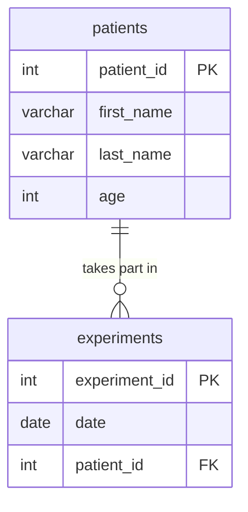
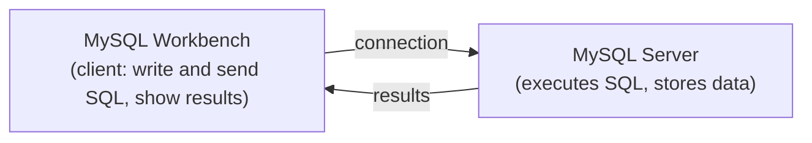

# Foreign Key Purpose, WHERE vs HAVING, Optional INSERT Columns, Workbench vs Server & Identifiers vs Keywords (Sample Questions)

> Part of: Databases & SQL
> **Sample Exam Questions**, course code 2455 / 4993, Uri Goldstein. A 2-page sheet of five sample questions with their published answers. Not a graded sitting: the text is dated February 2023, the header says "Sem. 1, 2024".
> Key concepts: [[Foreign Key]], [[Referential Integrity]], [[Primary Key]], [[WHERE]], [[HAVING]], [[GROUP BY]], [[Aggregate Function]], [[NULL]], [[NOT NULL]], [[INSERT]], [[MySQL Workbench]], [[MySQL Server]], [[Client-Server Architecture]], [[Identifier]], [[Keyword]]
> Same ideas appear in the graded paper: [[PP_01-Constraints, ER Modelling, FULL OUTER JOIN, HAVING vs WHERE & Foreign Keys (2024 Moed A)]]

> [!info] Answers from the instructor's answer file (unlabelled, treated as official).
> All five questions have a published answer on the sheet. Nothing here is AI-solved. The "Why" parts expand the official text and never change it.

> [!note] Sample questions, no marks
> The sheet gives no point values. The instructor says these are "like the ones that will be included in the final exam" and that some material may not yet have been covered. Each is a **short explain-in-words answer**: aim for 2 to 4 clear sentences.

## What this paper tests

Every question asks *what a SQL feature is for* or *when it happens*, never for a long query. The unlocking habit: answer with a **purpose** (why it exists) and a **timing or location** (when it runs, where it lives).

| Q | Core idea |
|---|---|
| Q1 | Why add a [[Foreign Key]]: [[Referential Integrity]] |
| Q2 | [[WHERE]] filters rows before grouping, [[HAVING]] filters groups after |
| Q3 | A column that is optional in an `INSERT` (nullable, so it defaults to `NULL`) |
| Q4 | Workbench is only a client; the server runs the SQL |
| Q5 | Identifier (a name in your database) vs keyword (part of the language) |

---

## Q1 — Why add a foreign key?

Below are two tables from a database of clinical trials in a new drug for the treatment of Largelanguagemodelitis, a severe disease that can affect young people in their early twenties to thirties.

**patients** (`patient_id` is the PK)

| patient_id | first_name | last_name | age |
|---|---|---|---|
| 1 | John | Doe | 25 |
| 2 | Jane | Doe | 43 |
| 3 | Jimmy | Doe | 22 |
| 4 | Jean | Doe | 27 |

**experiments** (`experiment_id` is the PK)

| experiment_id | date | patient_id |
|---|---|---|
| 1 | 01/01/2024 | 1 |
| 2 | 01/01/2024 | 2 |
| 3 | 01/02/2024 | 1 |
| 4 | 01/02/2024 | 2 |

Note that the values in the `patient_id` column in the `experiments` table are supposed to contain values from the `patient_id` column of the `patients` table. Note also that no foreign key constraint has been defined that links both columns to each other.

John the DBA (database administrator) has also noted the above and tells you: "Hey, I think you should add a foreign key constraint from the experiments table to the patients table!"

**Why is John right? What would adding this foreign key constraint provide and why is it important?**

> [!success] Answer
> John is right because there is a relationship between the two tables and relationships should be formalized as foreign key constraints in SQL databases. An FK constraint would ensure [[Referential Integrity]] from the `experiments` table to the `patients` table, and this is important for preventing errors where the FK column in `experiments` might contain values that are missing from the PK column in `patients`.

**Why.** Right now the link is only a convention in people's heads. The database does not know `experiments.patient_id` should match a patient, so it would accept an experiment for patient 99, who does not exist (an "orphan" row). The foreign key turns the convention into a rule the server enforces:

```sql
ALTER TABLE experiments
    ADD CONSTRAINT fk_experiments_patients
    FOREIGN KEY (patient_id) REFERENCES patients (patient_id);
```

With it, this insert is rejected with an error, because there is no patient 99:

```sql
INSERT INTO experiments (experiment_id, date, patient_id)
VALUES (5, '2024-01-03', 99);
```

Existing data is fine: every `experiments.patient_id` (1, 2, 1, 2) exists in `patients`. Patients 3 and 4 have no experiments yet, and that is allowed, since the rule only runs from child (`experiments`) to parent (`patients`).



> [!tip] Intuition
> Three things to say: (1) there is a relationship, (2) relationships belong in the schema as FKs, (3) the payoff is no missing or orphan parent values, which is referential integrity. This is the same "what is an FK for" idea as Q5 of [[PP_01-Constraints, ER Modelling, FULL OUTER JOIN, HAVING vs WHERE & Foreign Keys (2024 Moed A)]].

---

## Q2 — WHERE vs HAVING

The `SELECT` command can contain a `WHERE` clause and a `HAVING` clause. Both accept a predicate to filter out data. **Explain what the main difference is between these two clauses.**

> [!success] Answer
> The main difference is in the **timing** in which they are executed. The [[WHERE]] clause is executed earlier and filters out "raw" data taken from the table or tables included in the `FROM` clause. The [[HAVING]] clause is executed later, after the [[GROUP BY]] clause has been executed, and filters out data that is grouped according to the `GROUP BY` clause.

**Why.** The logical order is `FROM`, then `WHERE`, then `GROUP BY`, then `HAVING`, then `SELECT`. Because `WHERE` runs before groups exist, it can only test individual row values, so an [[Aggregate Function]] such as `SUM` is not allowed in it. `HAVING` runs after groups exist, so it can test a group's aggregate.

```sql
SELECT customer_id, SUM(amount) AS total_paid
FROM payment
WHERE amount > 0            -- filters raw rows, before grouping
GROUP BY customer_id
HAVING SUM(amount) > 100;   -- filters groups, after grouping
```

| Clause | Runs | Filters | Can use aggregates? |
|---|---|---|---|
| `WHERE` | Before `GROUP BY` | Individual rows from `FROM` | No |
| `HAVING` | After `GROUP BY` | Groups | Yes |

> [!tip] Intuition
> Say the word "timing" and name both clauses with what each filters (raw rows vs groups). Naming only "one is for aggregates" is true but misses the official point.

---

## Q3 — Optional columns in an INSERT

When inserting records into a table, some columns must be included in the `INSERT` command and values for them must be provided. Other columns are optional: they might be omitted from the `INSERT` command. **Give one example of when a column is optional for INSERT statements.**

> [!success] Answer
> An example of a column that does not have to be included in an `INSERT` command is a column that is defined to contain `NULL` values. In such a case, if the column is omitted from the `INSERT` command, MySQL will set its value to `NULL`.

**Why.** A column declared without [[NOT NULL]] is allowed to hold [[NULL]], so leaving it out is legal and the server fills in `NULL`.

```sql
CREATE TABLE patients (
    patient_id INT NOT NULL,
    first_name VARCHAR(45) NOT NULL,
    middle_name VARCHAR(45) NULL   -- optional
);

INSERT INTO patients (patient_id, first_name)   -- middle_name omitted
VALUES (5, 'Joan');                              -- middle_name becomes NULL
```

> [!tip] Other valid examples
> The official answer gives the nullable case, so lead with it. A column with a `DEFAULT` value or an `AUTO_INCREMENT` key can also be omitted, because the server supplies a value. Those are extensions, not the official wording. A `NOT NULL` column with no default must be provided.

---

## Q4 — Workbench without a server

Lisa has installed the latest stable version of MySQL Workbench on her laptop computer. Lisa did not install MySQL Server on her computer.

Lisa's laptop had an accident, fell to the floor, and now it can no longer connect to the internet. **Can Lisa run SQL commands on her computer? Explain how/why.**

> [!success] Answer
> Lisa **cannot** run SQL commands on her computer because she only has the Workbench program, and it is the Server program that executes the command. Lisa will need to either install MySQL Server on her computer somehow and connect to it, or get the computer fixed so that it can connect to a MySQL Server on the internet.

**Why.** This is [[Client-Server Architecture]]:



[[MySQL Workbench]] only provides the editor and result viewer. It sends the text to a [[MySQL Server]], which parses and runs it and holds the data. With no local server and no network path to a remote one, there is nothing to run the command. Two fixes, both in the official answer: install a server locally and connect to it, or restore the connection to a remote server.

> [!tip] Intuition
> Workbench is like a phone's browser, and the server is the website. A browser installed with no internet and no local site cannot show you anything.

---

## Q5 — Identifier vs keyword

**Explain what the difference is between an identifier and a keyword in the SQL language.**

> [!success] Answer
> In SQL, an **identifier** is a name of something in the database. For example, the name of a database, a table, or a column. Identifiers are specific to the database worked on.
>
> A **keyword** is a word that has a special meaning in SQL syntax. Different keywords have different meanings and together they can be combined into complex commands and queries. Keywords are not specific to the data, they are a part of the SQL language itself.

**Why.** Take one query and sort its words:

```sql
SELECT first_name, age
FROM patients
WHERE age > 25;
```

| Word | Kind | Reason |
|---|---|---|
| `SELECT`, `FROM`, `WHERE` | [[Keyword]] | Part of the SQL language, same in every database |
| `first_name`, `age` | [[Identifier]] | Column names chosen for this database |
| `patients` | [[Identifier]] | A table name specific to this database |

> [!tip] Intuition
> Keywords come with the language and mean the same everywhere. Identifiers are names the database designer chose, and only mean something inside this one database.

---

## Recap table

| Q | Topic | One-line answer |
|---|---|---|
| 1 | Why add the FK | The tables are related, and an FK enforces referential integrity: no value in `experiments.patient_id` missing from `patients.patient_id` |
| 2 | WHERE vs HAVING | Timing: `WHERE` filters raw rows early, `HAVING` filters groups after `GROUP BY` |
| 3 | Optional INSERT column | A nullable column; if omitted, MySQL sets it to `NULL` |
| 4 | Lisa, Workbench only | No: Workbench is a client, the Server executes SQL; install a server or restore connection to one |
| 5 | Identifier vs keyword | Identifier is a database-specific name; keyword is language syntax with special meaning |

## Related notes

- Graded paper covering the same ideas: [[PP_01-Constraints, ER Modelling, FULL OUTER JOIN, HAVING vs WHERE & Foreign Keys (2024 Moed A)]]
- Reading note on SQL keywords and exam tips (being written in parallel, not linked here).
